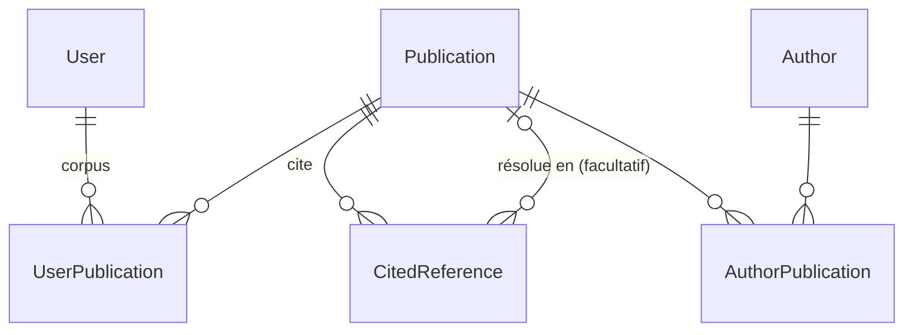

# Architecture

Ce document décrit l'organisation du projet et les décisions de conception. Les
éléments marqués **(cible)** ne sont pas encore en place : l'issue indiquée les
introduit.

## Principe

L'utilisateur ajoute un article à son **corpus**. L'application récupère alors depuis
Crossref les métadonnées de cet article et celles des articles qu'il cite. Les articles
cités ne sont pas explorés plus loin, sauf s'ils sont eux-mêmes ajoutés à un corpus.

Les données Crossref sont parfois incomplètes : DOI manquant dans une référence, auteurs
écrits de plusieurs façons. L'utilisateur peut les corriger : saisie d'un DOI, fusion
d'auteurs.

## Organisation du code

```
config/              configuration Django (settings, urls, wsgi, asgi)
accounts/            modèle utilisateur (accounts.User), inscription, templates registration/
references/          application principale
  models.py          modèle de données
  views/             une vue par domaine : home, publications, authors, corpus, graphs
  services/          logique métier, sans dépendance aux vues
    http.py          requêtes JSON communes (session, nouvelles tentatives, journalisation)
    external_records.py  stockage des réponses des sources (ExternalRecord)
    metadata_formats.py  conversion de chaque source vers le format lu par le parser
    crossref_api.py  client Crossref (polite pool, lots de DOI, recherche par ISBN)
    datacite_api.py  client DataCite (DOI par DOI ou par lots)
    openalex_api.py  client OpenAlex (DOI par DOI ou par lots)
    enrichment.py    sources complémentaires (OpenAlex), interrogées en plus des autres
    affiliations.py  rattachement des organisations aux signatures
    organizations.py organisations OpenAlex, hiérarchie et regroupement par tutelle
    names.py         normalisation des noms de personnes
    conflicts.py     signalement et décision des conflits entre sources
    orcid_completion.py  ORCID manquants complétés depuis OpenAlex
    openlibrary_api.py  client Open Library (recherche par ISBN)
    doi.py, isbn.py  normalisation et validation des identifiants
    books.py         livres identifiés par ISBN (Crossref, puis Open Library)
    identification.py  identification manuelle des références
    publication_merge.py  fusion d'une publication sans identifiant dans une autre
    importer.py      orchestration : récupération puis analyse
    parser.py        JSON Crossref vers modèles
    graph.py         construction des données des graphes
  templates/references/
  tests/
templates/base.html  gabarit commun
static/              CSS commun
```

Règles :

- Les **vues** restent fines : elles valident l'entrée, appellent un service et rendent
  la réponse.
- Les **services** portent la logique et se testent sans HTTP.
- Les tests ne font **aucun appel réseau** : Crossref est simulé, et le test runner
  (`config/test_runner.py`) fait échouer toute connexion réseau.

## Modèle de données

Le modèle sépare **ce que dit Crossref** (données brutes, jamais modifiées) de **ce qu'on
en déduit** (entités résolues, corrigeables). Ainsi, un ré-import n'écrase jamais une
correction.



| Modèle | Rôle |
|---|---|
| `Publication` | Un article ou un livre. DOI et ISBN (normalisé en ISBN-13) uniques quand ils sont renseignés. |
| `ExternalRecord` | La réponse brute d'une source externe (Crossref, Open Library…) sur une publication, avec sa date de récupération. Un seul enregistrement par source et par publication. Un JSON vide signifie que la source ne connaît pas la publication. Le parser lit le message de la source prioritaire, converti au format Crossref (`metadata_formats.py`). |
| `CitedReference` | Une entrée de la bibliographie d'un article, telle que Crossref la donne : clé, position, texte brut, DOI éventuel, entrée JSON complète. Son lien vers la `Publication` citée est **facultatif** : une référence sans DOI ne crée pas de publication vide. Une identification manuelle (par DOI ou en créant une publication sans identifiant) remplit ce lien et trace qui l'a faite et quand (`resolved_manually`, `resolved_by`, `resolved_at`). Elle est conservée au ré-import : la référence est retrouvée par sa clé Crossref, ou par sa position à défaut, et la correction l'emporte sur Crossref. |
| `Author` | Une personne (entité résolue). |
| `AuthorPublication` | Le lien entre un auteur et un article, dans l'ordre de signature. Il conserve le nom publié (prénom, nom, ORCID), ce qui permet de retrouver l'auteur canonique au ré-import, même après une fusion. |
| `Organization` | Une organisation de recherche (nom, ROR, identifiant OpenAlex, pays), issue des institutions d'OpenAlex, avec tous ses ancêtres (`ancestors`) selon la lignée OpenAlex. |
| `UserPublication` | Le corpus d'un utilisateur. |
| `accounts.User` | Modèle utilisateur du projet (`AUTH_USER_MODEL`), vide pour l'instant. Il est défini dès le départ pour pouvoir ajouter des champs ou changer l'identifiant de connexion sans migration délicate. |

**Décision : les corrections sont communes à tous les utilisateurs.** Les publications,
les auteurs, les DOI saisis et les fusions forment une base de connaissances partagée.
Seul le corpus (`UserPublication`) est propre à chaque utilisateur.

## Import Crossref

1. Les vues appellent **explicitement** les services : `services/corpus.add_to_corpus`
   pour un ajout au corpus, quel que soit le chemin, et `services/importer.import_publication`
   dans les autres cas. Créer une `Publication` n'appelle jamais Crossref : il n'y a pas
   de signal.
2. Les métadonnées d'un article ne sont récupérées que si aucune source ne l'a encore décrit.
   Le seul moyen de rappeler Crossref pour un article déjà récupéré est le bouton
   « Rafraîchir les métadonnées » (`force_fetch`).
3. Pour un article du corpus, les références sont analysées, puis les articles cités
   jamais récupérés sont importés, sans leurs propres références : on ne descend que d'un
   niveau.
4. Ces articles cités sont récupérés **par lots de 50** en une requête
   (`/works?filter=doi:A,doi:B,…`). Un DOI absent de la réponse est marqué comme
   récupéré, sans données, pour ne pas être redemandé par les imports suivants. Une
   action explicite (ajout au corpus, rafraîchissement) peut le redemander.
   Les fiches de ces requêtes de liste contiennent les mêmes auteurs et références qu'une
   requête unitaire. Il leur manque seulement des champs secondaires (`original-title`,
   `short-title`, `subject`, `subtitle`).

Mesuré sur un article de 1 012 auteurs et 100 références (88 avec DOI) : **3 requêtes
Crossref et environ 2 s**, réseau compris. Pour y arriver, l'analyse se fait dans une
transaction, sans les appels réseau. Les auteurs et les publications citées sont
résolus par requêtes groupées, et les créations passent par `bulk_create` : le nombre de
requêtes SQL ne croît pas avec le nombre d'auteurs ou de références.

**Décision : l'import est synchrone.** Grâce aux lots, il ne prend que quelques secondes
et ne demande aucune infrastructure supplémentaire. Le service est isolé des vues, si
bien qu'il pourra passer en tâche de fond plus tard sans toucher au reste.

Le client (`crossref_api.py`) s'identifie avec `CROSSREF_MAILTO` pour accéder au
*polite pool*. Il respecte `Retry-After` sur les erreurs 429, retente les 5xx et les
erreurs réseau, et ne retente jamais une 404 ni une 403.

## Corrections manuelles

- **Identifier une référence** (`identification.py`) : par DOI, par ISBN, ou en créant une
  publication sans identifiant. La correction est tracée et survit aux ré-imports.
- **« Cette publication est en fait… »** (`publication_merge.py`) : une publication sans
  DOI ni ISBN peut être fusionnée dans une autre, désignée par un DOI, un ISBN ou le lien
  de sa page. Ses citations sont reportées et marquées comme corrections manuelles, ses
  entrées de corpus sont reportées sans doublon, puis elle est supprimée. Une publication
  identifiée ne peut pas être fusionnée de cette façon.

## DOI enregistrés chez DataCite

Un DOI est attribué par une seule agence. **Crossref** couvre la plupart des articles,
**DataCite** les actes de conférence (JACoW, très cités en physique des accélérateurs),
les dépôts Zenodo et les jeux de données. Crossref répond « inconnu » pour un DOI DataCite.

- Un DOI isolé : Crossref, puis DataCite (`/dois/<doi>`).
- Les articles cités : un lot Crossref, puis **un lot DataCite** (`/dois?ids=A,B,…`) pour
  les seuls DOI que Crossref ne connaît pas. Un DOI inconnu des deux n'est enregistré
  comme tel que si DataCite a répondu : en cas de panne, il est retenté au prochain import.
- Une fiche DataCite (titres, créateurs avec ORCID, date) est convertie au format lu par le
  parser. Elle ne contient en général pas de bibliographie : seuls les liens déclarés
  `References` ou `Cites` vers des DOI deviennent des références.

## Fusion d'auteurs

`services/author_merge.py` : pour chaque champ (prénom, nom, ORCID), on propose les valeurs
des auteurs fusionnés, ou une autre valeur saisie. Par défaut, on prend la forme la plus
complète : sans initiale, pas tout en capitales, puis la plus longue. Pour l'ORCID, on
prend le premier existant. Deux ORCID différents désignent en général deux personnes :
la fusion demande alors une confirmation explicite. Les noms publiés restent sur chaque
publication (`AuthorPublication`), si bien qu'aucune variante n'est perdue et que la
fusion résiste aux ré-imports.

**Doublons probables** (`services/author_duplicates.py`). Les auteurs sont regroupés par
nom de famille normalisé, sans accents ni casse. Deux prénoms sont compatibles mot à mot :
identiques, ou une initiale qui correspond à la première lettre de l'autre (« J.-L. » et
« Jean Luc »). Un auteur n'entre dans un groupe que s'il est compatible avec **tous** ses
membres : sinon, « J. » relierait « John » et « James ». Deux ORCID différents ne sont
jamais regroupés, et deux auteurs qui ont le **même** ORCID le sont toujours, quelle que
soit l'écriture de leurs noms. Les noms de famille sont comparés sans tenir compte des
tirets ni de la ponctuation (« Correia-Machado » = « Correia Machado »). Les groupes qui comptent exactement un ORCID viennent en premier. La
page renvoie vers la fusion habituelle, après qu'on a éventuellement décoché des auteurs.
On peut aussi déclarer les auteurs cochés comme **personnes différentes**
(`AuthorDistinction`, paire stockée une fois, avec qui l'a déclarée et quand) : la paire
n'est plus jamais proposée, comme deux ORCID différents. Lors d'une fusion, les
distinctions de l'auteur absorbé sont reportées sur l'auteur conservé.

## OpenAlex, source complémentaire

[OpenAlex](https://openalex.org) n'est pas un recours comme DataCite : il est interrogé
pour **tous** les DOI importés, en plus de Crossref et DataCite, parce qu'il apporte autre
chose. On y trouve les institutions avec leur identifiant ROR, des ORCID absents de
Crossref, des identifiants d'auteurs et la date de mise en ligne. Il n'ajoute aucun
article : seuls ceux déjà importés (corpus et articles cités) sont complétés.

- Un article : une requête unitaire (gratuite). Elle n'est enregistrée que si OpenAlex a
  répondu, pour pouvoir la retenter en cas de panne.
- Les articles cités : un lot par 50 DOI (`filter=doi:A|B|…`). Un DOI absent d'une
  réponse est enregistré comme inconnu.
- Conditions (vérifiées le 2026-10-21) : API gratuite et sans clé. Une requête unitaire
  est illimitée. Les requêtes par lots consomment un budget quotidien d'environ 1 000 lots
  sans clé.

### Affiliations

Une affiliation est une propriété de la **signature** (`AuthorPublication.organizations`),
pas de la personne : « sur cet article, X a déclaré le laboratoire Y ». Les périodes d'un
auteur dans une organisation (première et dernière publication) **se calculent** et ne
sont pas stockées : un changement de laboratoire apparaît naturellement.

Les institutions viennent d'OpenAlex. Elles sont rattachées aux signatures par **position
et nom publié** : les mots du nom sont comparés quel que soit leur ordre, si bien que
« Thuillier, Thomas » (DataCite) correspond à « Thomas Thuillier ». Si le nombre d'auteurs
ou un nom diffère, rien n'est rattaché pour l'article. Une organisation est reconnue par
son identifiant OpenAlex ou par son ROR. Les liens sont recréés à chaque analyse, puisque
les signatures le sont aussi.

**Hiérarchie.** Les auteurs déclarent souvent plusieurs niveaux à la fois (« IRFU, CEA
Paris-Saclay »). OpenAlex donne la **lignée** de chaque institution, c'est-à-dire tous ses
ancêtres : IRFU appartient à la Direction de la Recherche Fondamentale, qui appartient au
CEA. Chaque organisation connaît ses ancêtres. Ceux qui ne figurent dans aucune signature
sont récupérés pendant l'étape OpenAlex, en une requête groupée (`/institutions?filter=
openalex:…`), pour que le parser n'ait jamais à appeler le réseau. Sur la fiche d'un
auteur, les organisations sont **regroupées par tutelle** (organisation sans ancêtre),
avec le détail des entités déclarées. Une unité mixte (CEA Paris-Saclay : CEA et
Université Paris-Saclay) apparaît sous chacune de ses tutelles.

La commande `complete_affiliations` complète les publications déjà en base à partir des
données OpenAlex stockées, sans les redemander. L'option `--fetch-missing` interroge
d'abord OpenAlex, par lots, pour celles qui n'ont pas encore de réponse.

### ORCID complétés depuis OpenAlex

Pour les auteurs rapprochés (même position, même nom publié), l'ORCID donné par OpenAlex
est attribué à l'**auteur** s'il n'en a pas. S'il en a un autre, rien ne change et un
conflit est signalé : « Prendre la valeur proposée » remplace alors l'ORCID. L'ORCID
publié de la signature (`published_orcid`, donnée Crossref) n'est jamais modifié : il fait
partie de la clé qui retrouve un auteur au ré-import. Mesuré sur la base réelle : les
auteurs avec ORCID passent de 35 à 74 sur 135, sans conflit. 11 ORCID se retrouvent
alors chacun sur plusieurs auteurs : ce sont des doublons certains.

### Informations contradictoires entre sources

Comparaison faite sur 50 articles réels : 7 « années différentes », qui sont en fait la
date de mise en ligne (OpenAlex) face à la date imprimée (Crossref). Aucun ORCID
contradictoire, et 151 ORCID ajoutés. Quelques noms canoniques OpenAlex corrigent des
fautes de la fiche (« Rodrinuez » devient « Rodriguez »).

1. **On n'écrase jamais rien** : chaque source garde sa réponse brute.
2. **Crossref et DataCite font référence** pour la fiche : titre, date, auteurs tels que
   publiés, références (données de l'éditeur).
3. **OpenAlex complète** seulement : institutions, ORCID manquants, date en ligne.
4. Les auteurs sont rapprochés par leur **position et leur nom publié**
   (`raw_author_name`). En cas de désaccord, rien n'est rattaché pour l'article.
5. Un **vrai conflit** (par exemple un ORCID différent de celui déjà connu) : l'existant est
   gardé et le conflit est signalé sur la page « Conflits » (`MetadataConflict`,
   `services/conflicts.py`). Un conflit n'est signalé qu'une fois (objet, champ, valeur
   proposée) : une décision n'est jamais rouverte par un ré-import. Un conflit devenu
   obsolète (les sources concordent de nouveau) disparaît. Un conflit **informatif**,
   comme des auteurs différents selon les sources où rien n'est à « prendre », se marque
   seulement « Vu ».
6. Les **corrections manuelles** l'emportent toujours.
7. Deux valeurs toutes deux justes (dates, nombres de citations) sont affichées avec leur
   source.

## Livres et ISBN

Un livre souvent cité sans DOI peut être identifié par son ISBN. On cherche d'abord dans
**Crossref** (`/works?filter=isbn:…`), qui connaît les livres académiques ayant un DOI.
On se replie ensuite sur **Open Library** (`/search.json?isbn=…`, gratuit et sans clé) :
un seul appel donne le titre, l'année et les noms des auteurs. Ces noms passent par la
même résolution que ceux de Crossref, mais sans ORCID. Les données stockées ne sont
jamais redemandées. Les deux clients partagent `services/http.py`, et donc les mêmes
règles de nouvelles tentatives.

Limite connue : Open Library mélange parfois auteurs et contributeurs (directeur de
collection…). On corrige alors par fusion ou par correction d'auteur.

## Graphes

**Décision : le serveur fournit les données, le navigateur dessine.**

- `services/graph.py` produit les éléments Cytoscape : les nœuds (titre, date, nombre de
  citations, lien) et les arêtes. Il fait deux requêtes, quelle que soit la taille du graphe.
- La vue intègre ces données dans la page avec `json_script`, sans route JSON séparée.
  `references/static/references/citation_graph.js` les affiche sur une frise
  chronologique : l'axe horizontal suit la date, et les articles non datés sont à gauche.
- **Cytoscape.js est embarqué** dans `static/vendor/cytoscape/` (version épinglée,
  intégrité vérifiée, voir son README) : les graphes fonctionnent hors ligne, sans
  service tiers.
- Plotly rendu côté serveur (4,8 Mo de JavaScript par page) et `networkx` sont abandonnés.

## Journal des décisions

| Date | Décision | Raison |
|---|---|---|
| 2026-10-21 | Corrections communes à tous les utilisateurs | Base de connaissances partagée, plus simple. Le corpus reste individuel. |
| 2026-10-21 | Import synchrone, références récupérées par lots | Divise les appels Crossref par environ 30, sans worker à exploiter. |
| 2026-10-21 | Graphes en JSON avec Cytoscape.js | Pages légères, interactivité côté client, cohérent avec la refonte Tailwind (M8). |
| 2026-10-21 | Cytoscape.js embarqué plutôt que chargé depuis un CDN | Fonctionne hors ligne, sans dépendance externe à l'exécution. Fichier léger (435 Ko). |
| 2026-10-21 | Adresse Crossref dans une variable d'environnement | Le dépôt est public. |
| 2026-10-21 | Pas de rapprochement automatique des références au texte identique | Sans DOI ni ISBN, rien ne prouve qu'il s'agit du même ouvrage : on identifie à la main, ou on fusionne des publications (#67). |
| 2026-10-21 | ISBN : Crossref d'abord, puis Open Library (titre, année, auteurs) | Gratuit, sans clé, un appel par livre. |
| 2026-10-21 | Réponses des sources dans une table dédiée (`ExternalRecord`) | Une nouvelle source (DataCite, ORCID…) ne demande ni nouveaux champs ni nouvelle logique de cache. |
| 2026-10-21 | DataCite en second recours pour les DOI, par lots | Les actes JACoW sont chez DataCite ; Crossref d'abord, puisqu'il couvre la majorité des DOI et fournit les bibliographies. |
| 2026-10-21 | OpenAlex en complément, pour tous les DOI importés | Institutions avec ROR et ORCID manquants ; une requête unitaire et un lot de plus par import. |
| 2026-10-21 | Politique face aux contradictions : Crossref et DataCite font référence, OpenAlex complète, conflits signalés | Comparaison sur 50 articles réels : les écarts sont surtout des dates de nature différente et des corrections de noms. |
| 2026-10-21 | Modèle utilisateur personnalisé et migrations repartant de zéro | La base était vide : seul moment où c'est gratuit. |
