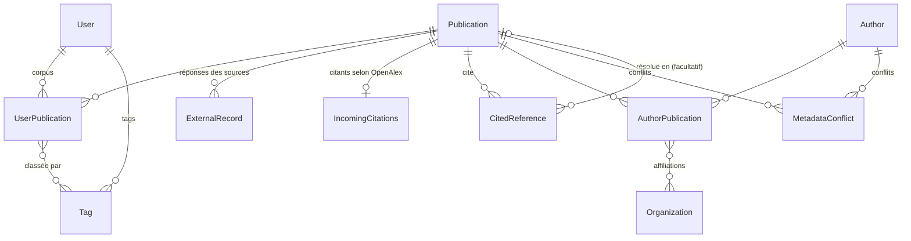

# Architecture

Ce document décrit l'organisation du projet et renvoie aux documents détaillés. La
documentation est mise à jour dans la même pull request que tout changement
d'architecture. Les règles de contribution (branches, commits, tests, conventions
d'interface) sont dans [CONTRIBUTING.md](../CONTRIBUTING.md).

## Principe

L'utilisateur ajoute un article à son **corpus**. L'application récupère alors ses
métadonnées et celles des articles qu'il cite : chez Crossref, ou chez DataCite pour les
DOI que Crossref ne connaît pas (actes de conférence, prépublications arXiv, Zenodo),
complétées par OpenAlex (institutions, ORCID, résumé) et ORCID (noms des auteurs). Les
articles cités ne sont pas explorés plus loin, sauf s'ils sont eux-mêmes ajoutés à un
corpus. Un article ajouté « à lire » n'importe que ses propres métadonnées.

Les données des sources sont parfois incomplètes ou contradictoires : référence sans DOI,
auteurs écrits de plusieurs façons, ORCID ou nom différents selon la source. L'utilisateur
les corrige (identification d'une référence, fusion d'auteurs ou de publications,
décision sur un conflit), et ces corrections sont **communes à tous** : les publications,
les auteurs et les décisions forment une base de connaissances partagée. Seuls le corpus,
le statut de lecture, les tags et les notes sont propres à chaque utilisateur.

## Documents

| Document | Contenu |
|---|---|
| [sources.md](sources.md) | Sources de métadonnées : ce que chacune apporte, **schéma du parcours d'un import**, titres (source et forme lisible), bibliographies, requêtes HTTP, DataCite, OpenAlex, livres, contradictions entre sources |
| [arxiv-jacow.md](arxiv-jacow.md) | Prépublications arXiv et actes JACoW : identifiants arXiv saisis, identifiants écrits dans les références, version publiée (déclarée ou selon OpenAlex), bibliographie tirée des sources LaTeX, ordre des auteurs JACoW |
| [auteurs.md](auteurs.md) | Auteurs : affiliations (OpenAlex, hiérarchie des organisations), ORCID complétés depuis OpenAlex, noms et profil ORCID |
| [corrections.md](corrections.md) | Identification des références (candidats, DOI vérifiés, série), corrections de publications et d'auteurs, fusions, doublons probables, conflits |
| [graphes.md](graphes.md) | Graphes de citations : données, disposition, style, vue, sélection, export ; graphe des auteurs (coautorat) ; carte des mots-clés |
| [banc-graphe.md](banc-graphe.md) | Banc d'essai des graphes (#202) : base grossie de vraies publications, graphes synthétiques, mesures de la disposition et de l'affichage, limites et pistes d'optimisation |
| [decouverte.md](decouverte.md) | Découverte d'articles : suggestions par co-citation, pour le corpus ou un tag ; citations entrantes selon OpenAlex |
| [interface.md](interface.md) | Navigation, tableaux, pagination, tri, filtres, recherche, accueil, mise en page |
| [decisions.md](decisions.md) | Journal des décisions, avec leurs raisons et leurs tickets |

## Organisation du code

```
config/              configuration Django (settings, urls, wsgi, asgi), test runner sans réseau
accounts/            modèle utilisateur (accounts.User), inscription, templates registration/
references/          application principale
  apps.py            configuration de l'application, fonction SQL normalized() de la recherche
  models.py          modèle de données
  admin.py           administration Django (seul endroit où l'on supprime une publication)
  forms.py           formulaires (publication, auteur, fusions, identification)
  urls.py            routes, au pluriel pour les collections (publications/, authors/…)
  middleware.py      contexte des requêtes aux sources faites pour une page (journal)
  context_processors.py  toast de la file des récupérations sur toutes les pages
  views/             vues fines, une par domaine
    home.py, publications.py, authors.py, corpus.py, graphs.py, conflicts.py,
    author_graphs.py (graphe des auteurs, coautorat),
    keywords.py (carte des mots-clés de « Mon corpus » ou d'un tag),
    graph_images.py (image d'un graphe trop grand pour la page : calcul, état, fichier),
    cited_references.py (identification d'une référence, en série),
    publication_merge.py (« Cette publication est en fait… »),
    corpus_transfer.py (export et import du corpus),
    corpus_bulk.py (actions groupées de « Mon corpus » et des listes d'une fiche),
    search.py (recherche), title_search.py (« Chercher par titre »),
    pagination.py (listes par pages),
    redirects.py (retour vers la page du formulaire, champ `next`, ou une page de repli),
    suggestions.py (suggestions de lecture),
    tag_context.py (tag demandé dans ?tag=, pour les suggestions et le graphe d'un tag)
    fetch_progress.py (avancement de la file, pour le toast),
    bibliographies.py (« Récupérer les bibliographies… » : confirmation, demande, « Arrêter »),
    author_suggestions.py (auteurs de la base suggérés pendant la frappe, JSON),
    fetch_admin.py (page « File des récupérations », réservée aux administrateurs)
  services/          logique métier, sans dépendance aux vues, un sous-paquet par domaine
    sources/         sources externes
      http.py        requêtes communes (session, nouvelles tentatives, découpe par lots,
                     cache de développement)
      api_log.py     journal des requêtes (logs/api.log, une ligne JSON par requête, contexte)
      api_log_summary.py  résumé du journal (commande api_log)
      crossref_api.py  client Crossref (polite pool, lots de DOI, recherche par ISBN ou par texte)
      datacite_api.py  client DataCite (DOI par DOI ou par lots, recherche par titre)
      openalex_api.py  client OpenAlex (DOI par DOI ou par lots, institutions, DOI d'une œuvre,
                     publications qui en citent une)
      openlibrary_api.py  client Open Library (recherche par ISBN)
      arxiv_api.py   client arXiv (sources LaTeX d'une prépublication, une à la fois)
      orcid_api.py   client de l'API publique ORCID (enregistrement d'une personne, noms par lots)
      doi_registration.py  existence des DOI saisis, demandée à doi.org
      external_records.py  stockage des réponses des sources (ExternalRecord), statut des
                     métadonnées
      metadata_formats.py  conversion de chaque source vers le format lu par le parser, priorité
    identifiers/     identifiants et noms
      doi.py, isbn.py, orcid.py  normalisation des identifiants (et validation des DOI et ISBN)
      arxiv.py       identifiants et liens arXiv vers leur DOI (10.48550/arXiv.…)
      names.py       normalisation et comparaison des noms de personnes
    imports/         import et analyse
      importer.py    orchestration : récupération puis analyse
      fetch_queue.py  file des récupérations (ajout, import de fichier, autres gestes longs)
                     traitée par fetch_worker, repli synchrone sans worker ; avancement des
                     demandes d'un utilisateur (toast)
      fetch_actions.py  ce que le worker fait pour chaque action de la file
      batch_import.py  import de plusieurs publications à la fois par le worker : chaque
                     étape interroge chaque source pour tout le lot (#381)
      fetch_admin.py  administration de la file : état des demandes et du worker, relancer
                     une demande échouée, annuler une demande en attente
      bibliography_levels.py  niveaux de bibliographies autour d'un point de départ, lus en
                     base : publications de chaque niveau, imports à faire, estimation (#431)
      bibliography_requests.py  demandes « Récupérer les bibliographies » jusqu'au niveau 2
                     ou 3 : un niveau après l'autre par la file, plafond, arrêt, toast (#431)
      parser.py      réponse de la source vers les modèles
      titles.py      titres : nettoyage (entités HTML, balisage JATS), forme lisible du LaTeX
      latex_bibliography.py  bibliographie lue dans les sources LaTeX d'une prépublication
      jacow.py       actes JACoW : codes écrits dans les références, ordre des auteurs incertain
      written_identifiers.py  références reliées par l'identifiant que leurs auteurs
                     écrivent (code JACoW, identifiant arXiv), après confirmation de DataCite
      author_resolution.py  noms publiés vers auteurs canoniques (ORCID, nom publié, nom)
      enrichment.py  sources complémentaires (OpenAlex), interrogées en plus des autres
      affiliations.py  rattachement des organisations aux signatures
      organizations.py  organisations OpenAlex, hiérarchie et regroupement par tutelle
      books.py       livres identifiés par ISBN (Crossref, puis Open Library)
      preprints.py   prépublications arXiv remplacées par leur version publiée déclarée
      published_versions.py  version publiée trouvée par OpenAlex, proposée comme conflit
      orcid_completion.py  ORCID manquants complétés depuis OpenAlex
      orcid_merge.py  fusion automatique des auteurs qui ont le même ORCID
      orcid_names.py  noms des auteurs complétés depuis ORCID
      orcid_profile.py  profil ORCID d'un auteur, demandé depuis sa fiche
    corrections/     corrections de la base commune
      identification.py  identification manuelle des références, « non identifiable », série
      candidates.py  publications candidates d'une référence (Crossref, DataCite, base)
      typed_authors.py  auteurs saisis d'une publication sans identifiant (lignes, suggestions, premier auteur cité)
      publication_merge.py  fusion d'une publication sans identifiant dans une autre
      publication_moves.py  report des entrées de corpus d'une publication vers une autre
      publication_edits.py  corrections de « Modifier » : titre et date protégés, nouvel identifiant
      author_merge.py  fusion d'auteurs (valeurs proposées, ORCID différents)
      author_duplicates.py  doublons probables (noms compatibles, ORCID, tutelle commune)
      author_distinctions.py  auteurs déclarés différents
      safe_duplicates.py  groupes sûrs de doublons probables, fusionnés en une fois après confirmation
      conflicts.py   signalement et décision des conflits entre sources
    corpus/          corpus personnel
      entries.py     ajout au corpus par DOI (ou arXiv) ou ISBN, statut de lecture
      tags.py        tags hiérarchiques du corpus (« Projet A/Groupe A »), arbre, filtre,
                     renommage et suppression, publications d'un tag (contexte)
      bulk.py        actions groupées sur les publications cochées : ajout, tag, statut, retrait
      corpus_transfer.py  export JSON et BibTeX du corpus, import (JSON, BibTeX, RIS)
      bibliography_files.py  identifiants des entrées d'un fichier BibTeX ou RIS (Zotero…)
      import_reports.py  compte rendu du dernier import de fichier, gardé en session
    discovery/       découverte d'articles
      suggestions.py  publications citées par plusieurs articles du corpus ou d'un tag
      incoming_citations.py  publications qui en citent une selon OpenAlex, à la demande
      title_search.py  publication cherchée par son titre pour l'ajouter (base, Crossref, DataCite)
    display/         affichage
      search.py      analyse de la barre de recherche, comparaison sans casse ni accents
      sorting.py     colonnes triables des tableaux (publications, auteurs)
      filters.py     filtres par colonne des tableaux (texte, plage d'années, choix)
      publication_table.py  annotations du tableau commun (premier auteur, badges)
      publication_details.py  informations de la fiche (revue, financeurs, licences, citations,
                     résumé)
      publication_page.py  contexte de la fiche publication, section par section (entrée du
                     corpus, références, « Cité par », listes longues repliées, actions groupées)
      citations.py   citation d'une publication (APA, IEEE) et son entrée BibTeX, sans requête
      open_access.py  « Lire l'article » : meilleure version en accès ouvert et sa licence, sans requête
      wording.py     mots des messages accordés avec un nombre (« 3 publications ajoutées »)
      pending.py     compteurs de la navigation (références à identifier, conflits ouverts)
      dashboard.py   tableau de bord de l'accueil
      graph.py       construction des données des graphes
      graph_variants.py  variantes d'un graphe choisies dans l'URL (frise ou réseau…)
      graph_images.py  image SVG d'un grand graphe, calculée sur le serveur (igraph)
      large_graph_layout.py  disposition de ces images : composante par composante, feuilles en couronne
      author_graph.py  graphe des auteurs (coautorat pondéré, grandes collaborations écartées)
      keyword_graph.py  carte des mots-clés ou des thèmes d'OpenAlex d'un corpus (co-occurrence,
                     seuil), et le filtre de « Mon corpus » sur un terme
      author_groups.py  doublons probables regroupés en un nœud du graphe des auteurs, sans toucher à la base
      icons.py       icônes SVG de static/icons/ (lecture, téléchargement)
  templatetags/
    ui/              composants d'interface, une seule bibliothèque () :
      library.py     la bibliothèque, où chaque module inscrit ses balises
      components.py  button, badge, alert, card
      icons.py       icon, external_link
      glass.py       verre dépoli : glass_classes, popover_panel_classes, notifications (toasts)
      tables.py      pagination, column_header (tri et filtre), sort_links, filter_summary,
                     row_title_classes
      forms.py       field, form_errors
      text.py        filtre pluralize_fr
    navigation.py    navigation principale (groupes, lien courant, compteurs, liens réservés
                     aux administrateurs)
  management/commands/
    api_log.py       résumé du journal des requêtes aux sources externes
    fetch_worker.py  worker de la file des récupérations
    dev.py           développement : tailwind runserver et fetch_worker dans un seul terminal
    complete_affiliations.py  affiliations des publications déjà en base
    complete_orcid_names.py  noms des auteurs déjà en base complétés depuis ORCID
    merge_same_orcid.py  fusion des auteurs déjà en base qui ont le même ORCID
    replace_preprints.py  prépublications arXiv déjà en base remplacées par leur version publiée
                     déclarée, ou version trouvée par OpenAlex proposée dans « Conflits »
    link_written_identifiers.py  références des bibliographies déjà importées reliées
                     par le code JACoW ou l'identifiant arXiv qu'elles écrivent
    reset_data.py    développement : efface toutes les données sauf les comptes et le cache
                     des sources (DEBUG seulement)
    add_icon.py      ajout d'une icône Material Symbols dans static/icons/
  static/references/graph/  graphes, en modules ES natifs (détail dans graphes.md)
    graph.js         mise en place commune à tous les graphes (cadre, création, liaisons)
    card.js          carte et sélection communes (appui, double appui, Échap, clic dans le vide)
    main.js          point d'entrée du graphe de citations (frise ou réseau)
    scale.js         dates et échelle de la frise
    layout.js        position des nœuds sur la frise
    band.js          bande des publications sans date
    network.js       vue « Réseau » (disposition cose)
    network-worker.js  la même disposition dans un Web Worker, pour un grand graphe
    viewport.js      cadrage, bornes de la vue, tailles fixes à l'écran
    focus.js         recentrage à la sélection
    stretch.js       étirement des positions à la sélection
    axis.js          axe des années
    selection.js     sélection d'une publication (carte commune de card.js)
    hover.js         survol : infobulle, liens foncés sur un petit graphe
    style.js         style des nœuds et des liens
    export.js        export PNG (partagé avec le graphe des auteurs)
    export_labels.js  placement des noms des nœuds sur l'image exportée
    coauthors.js     point d'entrée du graphe des auteurs (coautorat)
    coauthor_selection.js  sélection d'un auteur dans ce graphe
    keywords.js      point d'entrée de la carte des mots-clés (co-occurrence)
    keyword_selection.js  sélection d'un mot-clé : ses publications, ses voisins les plus liés
    keyword_labels.js  noms des mots-clés dessinés là où ils ne se chevauchent pas
    image_viewer.js  point d'entrée de la page qui parcourt l'image d'un grand graphe (#453)
    image_view.js    sa vue : zoom à la molette, déplacement, « Tout voir » (viewBox)
    image_pointer.js  le nœud sous le pointeur : infobulle, surbrillance, clic qui le sélectionne
    image_highlight.js  nœuds en surbrillance (survolé, sélectionnés et leurs liens), dans un SVG à part
    image_selection.js  nœuds sélectionnés, listés au-dessus de tous : centrer, page, retirer, tout désélectionner
    image_minimap.js  minicarte (points dans un canvas, rectangle de la partie vue)
    image_nodes.js   liste des nœuds : recherche, tri, seules les lignes visibles dessinées
  templates/references/  pages et gabarits partiels (_publication_table, _citation_graph, _graph_frame : cadre commun des graphes, étendu par _citation_graph, _author_graph et _keyword_graph…)
    publication_detail/  sections de la fiche publication, une par partiel (_header, _actions,
                     _authors, _abstract, _note, _information, _references, _cited_by,
                     _incoming_citations…), assemblées par publication_detail.html
    _corpus_add_form, _corpus_column_header, _cited_by_table_head, _first_author,
    _tag_link, _tag_filter_items  morceaux partagés par les tableaux de publications,
                     les suggestions, « Mon corpus » et la fiche (#296)
    _note_filter     champ « Chercher dans mes notes » de « Mon corpus » (#443)
  templates/components/  gabarits des composants de ui/
  tests/           tests ; sources.py simule les sources externes, fixtures/ leurs réponses
templates/base.html  gabarit commun (en-tête, navigation, <main>, notifications)
assets/css/source.css  source Tailwind (styles de base des éléments, couleurs du graphe)
static/
  css/tailwind.css   feuille compilée, non versionnée
  icons/             icônes SVG
  js/toasts.js       notifications
  js/fetch_progress.js  avancement de la file (toast), fiche rechargée une fois sa demande faite
  js/navigation.js   menus de la navigation sur petit écran
  js/search.js       raccourci Ctrl+K vers la barre de recherche
  js/identify_authors.js  liste des auteurs de « Sans identifiant » (suggestions, ordre)
  js/autosubmit.js   formulaires envoyés dès qu'une liste change (statut de lecture)
  js/bulk_actions.js  barre des actions groupées : compte, « Tout cocher », boutons désactivés, repli
  js/busy.js         boutons d'un formulaire envoyé désactivés, icône en attente
  js/copy_citation.js  boutons « Copier » du panneau « Citer » (HTML et texte)
  js/graph_image.js  image d'un grand graphe : état demandé jusqu'à ce qu'elle soit prête
  vendor/cytoscape/  Cytoscape.js embarqué
tools/check_js.sh    syntaxe de chaque fichier JavaScript (node --check), lancée par la CI (#341)
tools/graph_bench/   banc d'essai des graphes : base grossie, mesures de la disposition (bench.py) et du dessin pendant un geste (frames.py) dans Chrome headless (#202), libellés de l'export PNG (labels.py, #421), images de la page qui parcourt un grand graphe (image_frames.py, #453)
docs/                cette documentation
```

Règles :

- Les **vues** restent fines : elles valident l'entrée, appellent un service et rendent
  la réponse.
- Les **services** portent la logique et se testent sans HTTP. Ils sont rangés par domaine
  (`sources`, `identifiers`, `imports`, `corrections`, `corpus`, `discovery`, `display`) :
  un nouveau module va dans le sous-paquet de son domaine, et un client de source dans
  `sources/`.
- Les tests ne font **aucun appel réseau** : toutes les sources sont simulées au
  niveau HTTP (`references/tests/sources.py`, #299). Un adaptateur `requests` monté sur
  la session de `services/sources/http.py` répond selon l'URL et les paramètres, à
  partir des réponses que donne le test ou de `references/tests/fixtures/` ; les clients
  et le code HTTP commun tournent comme en production, et une requête non prévue fait
  échouer le test. Le test runner (`config/test_runner.py`) fait échouer toute connexion
  réseau et désactive le cache de développement.
- Les auteurs d'une liste de publications se préchargent avec
  `Publication.objects.….with_author_slots()` (signatures dans l'ordre, auteurs joints),
  jamais avec `prefetch_related("authorpublication_set__author")` : sur SQLite, Django
  filtre alors les auteurs par un `OR` par auteur, refusé au-delà de 1 000 (#268).

## Modèle de données

Le modèle sépare **ce que disent les sources** (réponses brutes, jamais modifiées) de
**ce qu'on en déduit** (entités résolues, corrigeables). Ainsi, un ré-import n'écrase
jamais une correction.



| Modèle | Rôle |
|---|---|
| `Publication` | Un article ou un livre. DOI et ISBN (normalisé en ISBN-13) uniques quand ils sont renseignés. `preprint_doi` garde le DOI arXiv d'une prépublication remplacée par sa version publiée (#227) : unique, il retrouve la publication quand on importe ou cite ce DOI (`Publication.objects.with_doi`). Le titre et la date viennent des sources ; corrigés à la main, ils sont marqués (`title_edited`, `date_edited`) et les sources ne les réécrivent plus. `readable_title` est le titre sans son LaTeX (« Nb₃Sn »), recalculé à chaque enregistrement : c'est lui qui est affiché, cherché et trié ; `title` reste celui de la source, pour « Modifier » et BibTeX (#264). La date est un `DateField` : un mois ou un jour absent de la source est stocké à 1, et `publication_date_precision` (année, mois, jour) dit ce que la source donne vraiment ; la fiche affiche « 2023 », « août 2023 » ou « 1 août 2023 » (#147). Une date saisie à la main est précise au jour. |
| `ExternalRecord` | La réponse brute d'une source externe (Crossref, DataCite, OpenAlex, arXiv, Open Library) sur une publication, avec sa date de récupération. Un seul enregistrement par source et par publication. Un JSON vide signifie que la source ne connaît pas la publication. Le parser lit le message de la source prioritaire, converti au format Crossref (`metadata_formats.py`). |
| `IncomingCitations` | Les publications qui en citent une selon OpenAlex, demandées depuis sa fiche (#163) : le nombre total et un résumé des 25 plus citées et des 25 plus récentes (`works`), avec la date. Aucune ne devient une `Publication` tant qu'on ne l'ajoute pas. Détails dans [decouverte.md](decouverte.md#citations-entrantes). |
| `CitedReference` | Une entrée de la bibliographie d'un article, telle que la source la donne : clé, position, texte brut, DOI éventuel, entrée JSON complète. Son lien vers la `Publication` citée est **facultatif** : une référence sans DOI ne crée pas de publication vide. Une identification manuelle remplit ce lien et trace qui l'a faite et quand (`resolved_manually`, `resolved_by`, `resolved_at`) ; une référence peut aussi être déclarée non identifiable (`unidentifiable`, avec la même trace). Ces décisions sont conservées au ré-import. Les candidats trouvés pour la page d'identification sont gardés en cache (`candidates`, `candidates_fetched_at`). Détails dans [corrections.md](corrections.md#identifier-une-référence). |
| `Author` | Une personne (entité résolue). Un nom corrigé à la main est marqué (`name_edited`) : ORCID ne le modifie plus. |
| `AuthorPublication` | Le lien entre un auteur et un article, dans l'ordre de signature. Il conserve le nom publié (prénom, nom, ORCID), ce qui permet de retrouver l'auteur canonique au ré-import, même après une fusion, et les organisations déclarées sur cette signature. |
| `AuthorMerge` | La trace d'une fusion d'auteurs : auteur conservé, auteurs absorbés tels qu'ils étaient (noms, ORCID), motif (manuelle ou même ORCID), qui (vide pour une fusion automatique) et quand. Les traces d'un auteur absorbé passent à l'auteur conservé. |
| `AuthorDistinction` | Une paire d'auteurs déclarés différents par un utilisateur (qui, quand) : la paire n'est plus proposée comme doublon et n'est jamais fusionnée automatiquement. |
| `OrcidRecord` | Ce qu'ORCID a répondu sur une personne, stocké tel quel : l'enregistrement public (noms, résumé des travaux, `data`), demandé depuis la fiche auteur, et les noms donnés par la recherche groupée (`search_data`, `{}` si ORCID ne connaît pas la personne), chacun avec sa date. Il est rattaché à l'ORCID et non à l'auteur : il survit aux fusions. |
| `Organization` | Une organisation de recherche (nom, ROR, identifiant OpenAlex, pays), issue des institutions d'OpenAlex, avec tous ses ancêtres (`ancestors`) selon la lignée OpenAlex. |
| `MetadataConflict` | Une valeur d'une source qui contredit une valeur connue, sur une publication ou un auteur : type, valeur retenue, valeur proposée, source, ce que la page affiche de la proposition (`details`), décision (ouvert, existant gardé, proposée retenue, vu), qui et quand. Signalé une seule fois. Détails dans [corrections.md](corrections.md#conflits). |
| `UserPublication` | Le corpus d'un utilisateur, avec le statut de lecture de chaque publication (`reading_status` : à lire, en cours, lu ; vide tant que l'utilisateur n'en a pas choisi), ses tags et sa note (`note`, texte libre et privé, #283). |
| `FetchRequest` | Une récupération auprès des sources laissée au worker (#378) : publication, identifiant demandé (DOI ou ISBN, gardé si la publication disparaît dans une fusion), action (importer, avec ou sans la bibliographie), état (en attente, en cours, faite, échouée), demandeurs, dates et erreur. Une seule demande active par publication et par action : un second demandeur rejoint la ligne existante. Les administrateurs relancent une demande échouée (elle repart en fin de file) ou annulent une demande en attente (elle passe en échouée, « Annulée par … ») depuis la page « File des récupérations » (#382). |
| `BibliographyRequest` | Une demande « Récupérer les bibliographies » d'un utilisateur (#431) : point de départ (une publication, « Mon corpus » ou un tag, et sa clé `start`), niveau demandé (`depth`, 2 ou 3), niveau en cours dans la file (`level`), plafond d'imports au moment de la demande (`limit`) et s'il a laissé des publications de côté (`capped`), état (en cours, terminée, arrêtée), dates, et si le toast a dit sa fin (`notified`). Une seule demande en cours par utilisateur et point de départ. |
| `BibliographyItem` | Une publication dont une `BibliographyRequest` veut la bibliographie, à son niveau, avec la `FetchRequest` qui l'importe (sans demandeur) ; aucune quand sa bibliographie est déjà en base ou qu'aucune source n'en a : elle ne coûte rien. |
| `FetchWorker` | La dernière date à laquelle `fetch_worker` s'est signalé (toutes les 10 s, même pendant un long import). Sans signe depuis 30 s, les pages font la récupération elles-mêmes. |
| `Tag` | Un tag d'un utilisateur, hiérarchique : son nom est un chemin, « Projet A/Groupe A », dont les parents existent implicitement. Unique par utilisateur, casse ignorée ; un tag qui ne classe plus aucune publication est oublié. |
| `accounts.User` | Modèle utilisateur du projet (`AUTH_USER_MODEL`), vide pour l'instant. Il est défini dès le départ pour pouvoir ajouter des champs ou changer l'identifiant de connexion sans migration délicate. |
