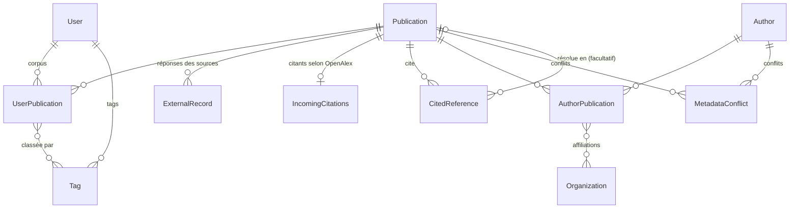

# Architecture

Ce document décrit l'organisation du projet et renvoie aux documents détaillés. La
documentation est mise à jour dans la même pull request que tout changement
d'architecture. Les règles de contribution (branches, commits, tests, conventions
d'interface) sont dans [CONTRIBUTING.md](../CONTRIBUTING.md).

## Principe

L'utilisateur ajoute un article à son **corpus**. L'application récupère alors ses
métadonnées et celles des articles qu'il cite : chez Crossref, ou chez DataCite pour les
DOI que Crossref ne connaît pas (actes de conférence, prépublications arXiv, Zenodo),
complétées par OpenAlex (institutions, ORCID, résumé) et ORCID (noms des auteurs). Les
articles cités ne sont pas explorés plus loin, sauf s'ils sont eux-mêmes ajoutés à un
corpus. Un article ajouté « à lire » n'importe que ses propres métadonnées.

Les données des sources sont parfois incomplètes ou contradictoires : référence sans DOI,
auteurs écrits de plusieurs façons, ORCID ou nom différents selon la source. L'utilisateur
les corrige (identification d'une référence, fusion d'auteurs ou de publications,
décision sur un conflit), et ces corrections sont **communes à tous** : les publications,
les auteurs et les décisions forment une base de connaissances partagée. Seuls le corpus,
le statut de lecture et les tags sont propres à chaque utilisateur.

## Documents

| Document | Contenu |
|---|---|
| [sources.md](sources.md) | Sources de métadonnées : ce que chacune apporte, **schéma du parcours d'un import**, requêtes HTTP, DataCite, prépublications arXiv, JACoW, OpenAlex et affiliations, ORCID, livres, contradictions entre sources |
| [corrections.md](corrections.md) | Identification des références (candidats, DOI vérifiés, série), corrections de publications et d'auteurs, fusions, doublons probables, conflits |
| [graphes.md](graphes.md) | Graphes de citations : données, disposition, style, vue, sélection, export |
| [decouverte.md](decouverte.md) | Découverte d'articles : suggestions par co-citation, pour le corpus ou un tag ; citations entrantes selon OpenAlex |
| [interface.md](interface.md) | Navigation, tableaux, pagination, tri, filtres, recherche, accueil, mise en page |
| [decisions.md](decisions.md) | Journal des décisions, avec leurs raisons et leurs tickets |

## Organisation du code

```
config/              configuration Django (settings, urls, wsgi, asgi), test runner sans réseau
accounts/            modèle utilisateur (accounts.User), inscription, templates registration/
references/          application principale
  models.py          modèle de données
  admin.py           administration Django (seul endroit où l'on supprime une publication)
  forms.py           formulaires (publication, auteur, fusions, identification)
  urls.py            routes, au pluriel pour les collections (publications/, authors/…)
  views/             vues fines, une par domaine
    home.py, publications.py, authors.py, corpus.py, graphs.py, conflicts.py,
    cited_references.py (identification d'une référence, en série),
    publication_merge.py (« Cette publication est en fait… »),
    corpus_transfer.py (export et import du corpus),
    search.py (recherche), pagination.py (listes par pages),
    suggestions.py (suggestions de lecture)
  services/          logique métier, sans dépendance aux vues
    Sources externes
    http.py          requêtes communes (session, nouvelles tentatives, cache de développement)
    crossref_api.py  client Crossref (polite pool, lots de DOI, recherche par ISBN ou par texte)
    datacite_api.py  client DataCite (DOI par DOI ou par lots, recherche par titre)
    openalex_api.py  client OpenAlex (DOI par DOI ou par lots, institutions, DOI d'une œuvre,
                     publications qui en citent une)
    openlibrary_api.py  client Open Library (recherche par ISBN)
    arxiv_api.py     client arXiv (sources LaTeX d'une prépublication, une à la fois)
    orcid_api.py     client de l'API publique ORCID (enregistrement d'une personne, noms par lots)
    doi_registration.py  existence des DOI saisis, demandée à doi.org
    external_records.py  stockage des réponses des sources (ExternalRecord), statut des métadonnées
    metadata_formats.py  conversion de chaque source vers le format lu par le parser, priorité
    Import et analyse
    importer.py      orchestration : récupération puis analyse
    corpus.py        ajout au corpus par DOI ou ISBN, statut de lecture
    tags.py          tags hiérarchiques du corpus (« Projet A/Groupe A »), arbre, filtre,
                     renommage et suppression
    parser.py        réponse de la source vers les modèles
    titles.py        nettoyage des titres (entités HTML, balisage JATS)
    latex_bibliography.py  bibliographie lue dans les sources LaTeX d'une prépublication
    jacow.py         actes JACoW : codes écrits dans les références, ordre des auteurs incertain
    author_resolution.py  noms publiés vers auteurs canoniques (ORCID, nom publié, nom)
    enrichment.py    sources complémentaires (OpenAlex), interrogées en plus des autres
    affiliations.py  rattachement des organisations aux signatures
    organizations.py organisations OpenAlex, hiérarchie et regroupement par tutelle
    orcid_completion.py  ORCID manquants complétés depuis OpenAlex
    orcid_merge.py   fusion automatique des auteurs qui ont le même ORCID
    orcid_profile.py profil ORCID d'un auteur, demandé depuis sa fiche
    orcid_names.py   noms des auteurs complétés depuis ORCID
    preprints.py     prépublications arXiv remplacées par leur version publiée déclarée
    published_versions.py  version publiée trouvée par OpenAlex, proposée comme conflit
    books.py         livres identifiés par ISBN (Crossref, puis Open Library)
    Identifiants et noms
    doi.py, isbn.py, orcid.py  normalisation des identifiants (et validation des DOI et ISBN)
    names.py         normalisation et comparaison des noms de personnes
    Corrections
    identification.py  identification manuelle des références, « non identifiable », série
    candidates.py    publications candidates d'une référence (Crossref, DataCite, base)
    publication_merge.py  fusion d'une publication sans identifiant dans une autre
    publication_moves.py  report des entrées de corpus d'une publication vers une autre
    publication_edits.py  corrections de « Modifier » : titre et date protégés, nouvel identifiant
    author_merge.py  fusion d'auteurs (valeurs proposées, ORCID différents)
    author_duplicates.py  doublons probables (noms compatibles, ORCID, tutelle commune)
    author_distinctions.py  auteurs déclarés différents
    conflicts.py     signalement et décision des conflits entre sources
    Découverte
    suggestions.py   publications citées par plusieurs articles du corpus ou d'un tag
    incoming_citations.py  publications qui en citent une selon OpenAlex, à la demande
    Affichage et échanges
    search.py        analyse de la barre de recherche, comparaison sans casse ni accents
    sorting.py       colonnes triables des tableaux (publications, auteurs)
    filters.py       filtres par colonne des tableaux (texte, plage d'années, choix)
    publication_table.py  annotations du tableau commun (premier auteur, badges)
    publication_details.py  informations de la fiche (revue, financeurs, licences, citations, résumé)
    pending.py       compteurs de la navigation (références à identifier, conflits ouverts)
    dashboard.py     tableau de bord de l'accueil
    graph.py         construction des données des graphes
    corpus_transfer.py  export JSON et BibTeX du corpus, import (JSON, BibTeX, RIS)
    bibliography_files.py  identifiants des entrées d'un fichier BibTeX ou RIS (Zotero…)
    icons.py         icônes SVG de static/icons/ (lecture, téléchargement)
  templatetags/
    ui.py            composants d'interface : button, badge, alert, card, icon, external_link,
                     pagination, column_header, filter_summary, popover_panel_classes
    navigation.py    navigation principale (groupes, lien courant, compteurs)
  management/commands/
    complete_affiliations.py  affiliations des publications déjà en base
    complete_orcid_names.py  noms des auteurs déjà en base complétés depuis ORCID
    merge_same_orcid.py  fusion des auteurs déjà en base qui ont le même ORCID
    replace_preprints.py  prépublications arXiv déjà en base remplacées par leur version publiée
                     déclarée, ou version trouvée par OpenAlex proposée dans « Conflits »
    reset_data.py    développement : efface toutes les données sauf les comptes et le cache
                     des sources (DEBUG seulement)
    add_icon.py      ajout d'une icône Material Symbols dans static/icons/
  static/references/graph/  graphe, en modules ES (main, scale, layout, viewport, focus, export, axis, selection, style)
  templates/references/  pages et gabarits partiels (_publication_table, _citation_graph…)
  templates/components/  gabarits des composants de ui.py
  tests/
templates/base.html  gabarit commun (en-tête, navigation, <main>, notifications)
assets/css/source.css  source Tailwind (styles de base des éléments, couleurs du graphe)
static/
  css/tailwind.css   feuille compilée, non versionnée
  icons/             icônes SVG
  js/toasts.js       notifications
  js/navigation.js   menus de la navigation sur petit écran
  js/search.js       raccourci Ctrl+K vers la barre de recherche
  js/autosubmit.js   formulaires envoyés dès qu'une liste change (statut de lecture)
  vendor/cytoscape/  Cytoscape.js embarqué
docs/                cette documentation
```

Règles :

- Les **vues** restent fines : elles valident l'entrée, appellent un service et rendent
  la réponse.
- Les **services** portent la logique et se testent sans HTTP.
- Les tests ne font **aucun appel réseau** : toutes les sources sont simulées
  (`references/tests/helpers.py`), et le test runner (`config/test_runner.py`) fait
  échouer toute connexion réseau et désactive le cache de développement.

## Modèle de données

Le modèle sépare **ce que disent les sources** (réponses brutes, jamais modifiées) de
**ce qu'on en déduit** (entités résolues, corrigeables). Ainsi, un ré-import n'écrase
jamais une correction.



| Modèle | Rôle |
|---|---|
| `Publication` | Un article ou un livre. DOI et ISBN (normalisé en ISBN-13) uniques quand ils sont renseignés. `preprint_doi` garde le DOI arXiv d'une prépublication remplacée par sa version publiée (#227) : unique, il retrouve la publication quand on importe ou cite ce DOI (`Publication.objects.with_doi`). Le titre et la date viennent des sources ; corrigés à la main, ils sont marqués (`title_edited`, `date_edited`) et les sources ne les réécrivent plus. La date est un `DateField` : un mois ou un jour absent de la source est stocké à 1, et `publication_date_precision` (année, mois, jour) dit ce que la source donne vraiment ; la fiche affiche « 2023 », « août 2023 » ou « 1 août 2023 » (#147). Une date saisie à la main est précise au jour. |
| `ExternalRecord` | La réponse brute d'une source externe (Crossref, DataCite, OpenAlex, arXiv, Open Library) sur une publication, avec sa date de récupération. Un seul enregistrement par source et par publication. Un JSON vide signifie que la source ne connaît pas la publication. Le parser lit le message de la source prioritaire, converti au format Crossref (`metadata_formats.py`). |
| `IncomingCitations` | Les publications qui en citent une selon OpenAlex, demandées depuis sa fiche (#163) : le nombre total et un résumé des 25 plus citées et des 25 plus récentes (`works`), avec la date. Aucune ne devient une `Publication` tant qu'on ne l'ajoute pas. Détails dans [decouverte.md](decouverte.md#citations-entrantes). |
| `CitedReference` | Une entrée de la bibliographie d'un article, telle que la source la donne : clé, position, texte brut, DOI éventuel, entrée JSON complète. Son lien vers la `Publication` citée est **facultatif** : une référence sans DOI ne crée pas de publication vide. Une identification manuelle remplit ce lien et trace qui l'a faite et quand (`resolved_manually`, `resolved_by`, `resolved_at`) ; une référence peut aussi être déclarée non identifiable (`unidentifiable`, avec la même trace). Ces décisions sont conservées au ré-import. Les candidats trouvés pour la page d'identification sont gardés en cache (`candidates`, `candidates_fetched_at`). Détails dans [corrections.md](corrections.md#identifier-une-référence). |
| `Author` | Une personne (entité résolue). Un nom corrigé à la main est marqué (`name_edited`) : ORCID ne le modifie plus. |
| `AuthorPublication` | Le lien entre un auteur et un article, dans l'ordre de signature. Il conserve le nom publié (prénom, nom, ORCID), ce qui permet de retrouver l'auteur canonique au ré-import, même après une fusion, et les organisations déclarées sur cette signature. |
| `AuthorMerge` | La trace d'une fusion d'auteurs : auteur conservé, auteurs absorbés tels qu'ils étaient (noms, ORCID), motif (manuelle ou même ORCID), qui (vide pour une fusion automatique) et quand. Les traces d'un auteur absorbé passent à l'auteur conservé. |
| `AuthorDistinction` | Une paire d'auteurs déclarés différents par un utilisateur (qui, quand) : la paire n'est plus proposée comme doublon et n'est jamais fusionnée automatiquement. |
| `OrcidRecord` | Ce qu'ORCID a répondu sur une personne, stocké tel quel : l'enregistrement public (noms, résumé des travaux, `data`), demandé depuis la fiche auteur, et les noms donnés par la recherche groupée (`search_data`, `{}` si ORCID ne connaît pas la personne), chacun avec sa date. Il est rattaché à l'ORCID et non à l'auteur : il survit aux fusions. |
| `Organization` | Une organisation de recherche (nom, ROR, identifiant OpenAlex, pays), issue des institutions d'OpenAlex, avec tous ses ancêtres (`ancestors`) selon la lignée OpenAlex. |
| `MetadataConflict` | Une valeur d'une source qui contredit une valeur connue, sur une publication ou un auteur : type, valeur retenue, valeur proposée, source, ce que la page affiche de la proposition (`details`), décision (ouvert, existant gardé, proposée retenue, vu), qui et quand. Signalé une seule fois. Détails dans [corrections.md](corrections.md#conflits). |
| `UserPublication` | Le corpus d'un utilisateur, avec le statut de lecture de chaque publication (`reading_status` : à lire, en cours, lu ; vide tant que l'utilisateur n'en a pas choisi), et ses tags. |
| `Tag` | Un tag d'un utilisateur, hiérarchique : son nom est un chemin, « Projet A/Groupe A », dont les parents existent implicitement. Unique par utilisateur, casse ignorée ; un tag qui ne classe plus aucune publication est oublié. |
| `accounts.User` | Modèle utilisateur du projet (`AUTH_USER_MODEL`), vide pour l'instant. Il est défini dès le départ pour pouvoir ajouter des champs ou changer l'identifiant de connexion sans migration délicate. |
