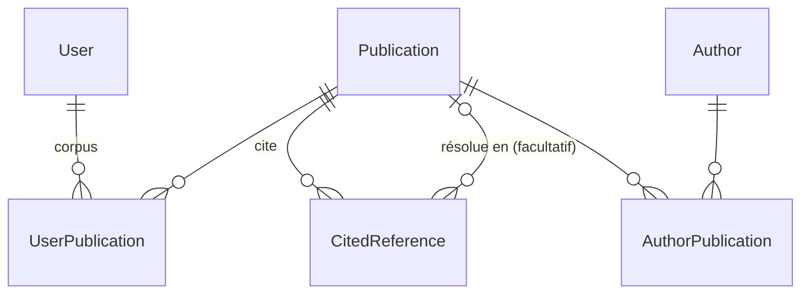

# Architecture

Ce document décrit l'organisation du projet et les décisions de conception. Les
éléments marqués **(cible)** ne sont pas encore en place : l'issue indiquée les
introduit.

## Principe

L'utilisateur ajoute un article à son **corpus**. L'application récupère alors depuis
Crossref les métadonnées de cet article et celles des articles qu'il cite. Les articles
cités ne sont pas explorés plus loin, sauf s'ils sont eux-mêmes ajoutés à un corpus.

Les données Crossref sont parfois incomplètes : DOI manquant dans une référence, auteurs
écrits de plusieurs façons. L'utilisateur peut les corriger : saisie d'un DOI, fusion
d'auteurs.

## Organisation du code

```
config/              configuration Django (settings, urls, wsgi, asgi)
accounts/            inscription, templates registration/
references/          application principale
  models.py          modèle de données
  views/             une vue par domaine : home, publications, authors, corpus, graphs
  services/          logique métier, sans dépendance aux vues
    crossref_api.py  client HTTP Crossref (polite pool, nouvelles tentatives)
    doi.py           normalisation et validation des DOI
    importer.py      orchestration : récupération puis analyse
    parser.py        JSON Crossref vers modèles
    graph.py         construction des données des graphes
  templates/references/
  tests/
templates/base.html  gabarit commun
static/              CSS commun
```

Règles :

- Les **vues** restent fines : elles valident l'entrée, appellent un service et rendent
  la réponse.
- Les **services** portent la logique et se testent sans HTTP.
- Les tests ne font **aucun appel réseau** : Crossref est simulé.

## Modèle de données

Le modèle sépare **ce que dit Crossref** (données brutes, jamais modifiées) de **ce qu'on
en déduit** (entités résolues, corrigeables). Ainsi, un ré-import n'écrase jamais une
correction.



| Modèle | Rôle |
|---|---|
| `Publication` | Un article. DOI unique quand il est renseigné **(cible, #49)**. Le JSON Crossref est stocké tel quel, avec sa date de récupération `crossref_fetched_at` **(cible, #49)**. |
| `CitedReference` **(cible, #49)** | Une entrée de la bibliographie d'un article, telle que Crossref la donne : clé, position, texte brut, DOI éventuel. Son lien vers la `Publication` citée est **facultatif**. Saisir un DOI à la main revient à remplir ce lien (M4). Remplace `PublicationReference`. |
| `Author` | Une personne (entité résolue). |
| `AuthorPublication` | Le lien entre un auteur et un article, dans l'ordre de signature. Il conserve le nom publié (prénom, nom, ORCID) **(cible, #49)**, ce qui permet de retrouver l'auteur canonique au ré-import, même après une fusion. |
| `UserPublication` | Le corpus d'un utilisateur. |

**Décision : les corrections sont communes à tous les utilisateurs.** Les publications,
les auteurs, les DOI saisis et les fusions forment une base de connaissances partagée.
Seul le corpus (`UserPublication`) est propre à chaque utilisateur.

## Import Crossref

Cible (M3 : #7, #6, #51) :

1. Une vue appelle **explicitement** le service d'import. Il n'y a plus de signal
   `post_save` (#7).
2. L'article est récupéré s'il n'a jamais été importé. On ne refait pas d'appel si
   `crossref_fetched_at` est renseigné, sauf rafraîchissement demandé (#6).
3. Les DOI cités, absents de la base, sont récupérés **par lots de 50** en une requête
   (`/works?filter=doi:A,doi:B,…`, #51). Un article à 100 références coûte ainsi environ
   3 requêtes au lieu de 101.

**Décision : l'import est synchrone.** Grâce aux lots, il ne prend que quelques secondes
et ne demande aucune infrastructure supplémentaire. Le service est isolé des vues, si
bien qu'il pourra passer en tâche de fond plus tard sans toucher au reste.

Le client (`crossref_api.py`) s'identifie avec `CROSSREF_MAILTO` pour accéder au
*polite pool*. Il respecte `Retry-After` sur les erreurs 429, retente les 5xx et les
erreurs réseau, et ne retente jamais une 404 ni une 403.

## Graphes

**Décision : le serveur fournit les données, le navigateur dessine** **(cible, #50)**.

- `services/graph.py` produit les nœuds (titre, date, nombre de citations) et les arêtes.
- Une vue JSON expose ces données, et les templates les affichent avec Cytoscape.js,
  chargé depuis un CDN en version épinglée.
- On abandonne Plotly rendu côté serveur, qui embarquait 4,8 Mo de JavaScript par page,
  ainsi que `networkx`.

## Journal des décisions

| Date | Décision | Raison |
|---|---|---|
| 2026-10-21 | Corrections communes à tous les utilisateurs | Base de connaissances partagée, plus simple. Le corpus reste individuel. |
| 2026-10-21 | Import synchrone, références récupérées par lots | Divise les appels Crossref par environ 30, sans worker à exploiter. |
| 2026-10-21 | Graphes en JSON avec Cytoscape.js | Pages légères, interactivité côté client, cohérent avec la refonte Tailwind (M8). |
| 2026-10-21 | Adresse Crossref dans une variable d'environnement | Le dépôt est public. |
