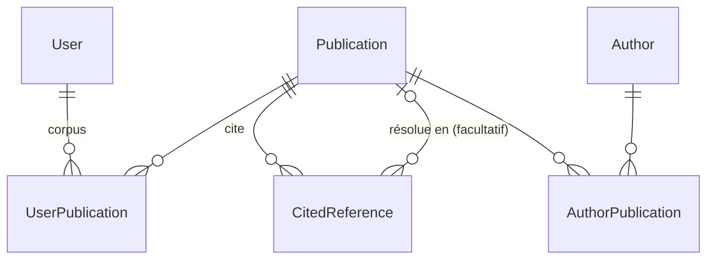

# Architecture

Ce document décrit l'organisation du projet et les décisions de conception. Il est mis
à jour dans la même pull request que tout changement d'architecture. Les règles de
contribution (branches, commits, tests, conventions d'interface) sont dans
[CONTRIBUTING.md](../CONTRIBUTING.md).

## Principe

L'utilisateur ajoute un article à son **corpus**. L'application récupère alors depuis
Crossref les métadonnées de cet article et celles des articles qu'il cite. Les articles
cités ne sont pas explorés plus loin, sauf s'ils sont eux-mêmes ajoutés à un corpus.

Les données Crossref sont parfois incomplètes : DOI manquant dans une référence, auteurs
écrits de plusieurs façons. L'utilisateur peut les corriger : saisie d'un DOI, fusion
d'auteurs.

## Organisation du code

```
config/              configuration Django (settings, urls, wsgi, asgi), test runner sans réseau
accounts/            modèle utilisateur (accounts.User), inscription, templates registration/
references/          application principale
  models.py          modèle de données
  admin.py           administration Django (seul endroit où l'on supprime une publication)
  forms.py           formulaires (publication, auteur, fusions, identification)
  urls.py            routes, au pluriel pour les collections (publications/, authors/…)
  views/             vues fines, une par domaine
    home.py, publications.py, authors.py, corpus.py, graphs.py, conflicts.py,
    cited_references.py (identification d'une référence),
    publication_merge.py (« Cette publication est en fait… »),
    corpus_transfer.py (export et import du corpus)
  services/          logique métier, sans dépendance aux vues
    Sources externes
    http.py          requêtes JSON communes (session, nouvelles tentatives, journalisation)
    crossref_api.py  client Crossref (polite pool, lots de DOI, recherche par ISBN)
    datacite_api.py  client DataCite (DOI par DOI ou par lots)
    openalex_api.py  client OpenAlex (DOI par DOI ou par lots, institutions)
    openlibrary_api.py  client Open Library (recherche par ISBN)
    orcid_api.py     client de l'API publique ORCID (enregistrement d'une personne)
    external_records.py  stockage des réponses des sources (ExternalRecord), statut des métadonnées
    metadata_formats.py  conversion de chaque source vers le format lu par le parser
    Import et analyse
    importer.py      orchestration : récupération puis analyse
    corpus.py        ajout au corpus (import avec les références)
    parser.py        réponse de la source vers les modèles
    titles.py        nettoyage des titres (entités HTML, balisage JATS)
    author_resolution.py  noms publiés vers auteurs canoniques (ORCID, nom publié, nom)
    enrichment.py    sources complémentaires (OpenAlex), interrogées en plus des autres
    affiliations.py  rattachement des organisations aux signatures
    organizations.py organisations OpenAlex, hiérarchie et regroupement par tutelle
    orcid_completion.py  ORCID manquants complétés depuis OpenAlex
    orcid_merge.py   fusion automatique des auteurs qui ont le même ORCID
    orcid_profile.py profil ORCID d'un auteur, demandé depuis sa fiche
    books.py         livres identifiés par ISBN (Crossref, puis Open Library)
    Identifiants et noms
    doi.py, isbn.py, orcid.py  normalisation des identifiants (et validation des DOI et ISBN)
    names.py         normalisation des noms de personnes
    Corrections
    identification.py  identification manuelle des références, « non identifiable »
    publication_merge.py  fusion d'une publication sans identifiant dans une autre
    publication_edits.py  corrections de « Modifier » : titre et date protégés, nouvel identifiant
    author_merge.py  fusion d'auteurs (valeurs proposées, ORCID différents)
    author_duplicates.py  doublons probables (noms compatibles, ORCID, tutelle commune)
    author_distinctions.py  auteurs déclarés différents
    conflicts.py     signalement et décision des conflits entre sources
    Affichage et échanges
    publication_table.py  annotations du tableau commun (premier auteur, badges)
    publication_details.py  informations de la fiche (revue, financeurs, licences, citations, résumé)
    graph.py         construction des données des graphes
    corpus_transfer.py  export JSON et BibTeX du corpus, import JSON
    icons.py         icônes SVG de static/icons/ (lecture, téléchargement)
  templatetags/
    ui.py            composants d'interface : button, badge, alert, card, icon, external_link
    navigation.py    navigation principale (groupes, lien courant)
  management/commands/
    complete_affiliations.py  affiliations des publications déjà en base
    merge_same_orcid.py  fusion des auteurs déjà en base qui ont le même ORCID
    add_icon.py      ajout d'une icône Material Symbols dans static/icons/
  static/references/graph/  graphe, en modules ES (main, scale, layout, viewport, focus, export, axis, selection, style)
  templates/references/  pages et gabarits partiels (_publication_table, _citation_graph…)
  templates/components/  gabarits des composants de ui.py
  tests/
templates/base.html  gabarit commun (en-tête, navigation, <main>, notifications)
assets/css/source.css  source Tailwind (styles de base des éléments)
static/
  css/tailwind.css   feuille compilée, non versionnée
  icons/             icônes SVG
  js/toasts.js       notifications
  vendor/cytoscape/  Cytoscape.js embarqué
docs/                cette documentation
```

Règles :

- Les **vues** restent fines : elles valident l'entrée, appellent un service et rendent
  la réponse.
- Les **services** portent la logique et se testent sans HTTP.
- Les tests ne font **aucun appel réseau** : Crossref est simulé, et le test runner
  (`config/test_runner.py`) fait échouer toute connexion réseau.

## Modèle de données

Le modèle sépare **ce que dit Crossref** (données brutes, jamais modifiées) de **ce qu'on
en déduit** (entités résolues, corrigeables). Ainsi, un ré-import n'écrase jamais une
correction.



| Modèle | Rôle |
|---|---|
| `Publication` | Un article ou un livre. DOI et ISBN (normalisé en ISBN-13) uniques quand ils sont renseignés. Le titre et la date viennent des sources ; corrigés à la main, ils sont marqués (`title_edited`, `date_edited`) et les sources ne les réécrivent plus. La date est un `DateField` : un mois ou un jour absent de la source est stocké à 1, et `publication_date_precision` (année, mois, jour) dit ce que la source donne vraiment ; la fiche affiche « 2023 », « août 2023 » ou « 1 août 2023 » (#147). Une date saisie à la main est précise au jour. |
| `ExternalRecord` | La réponse brute d'une source externe (Crossref, Open Library…) sur une publication, avec sa date de récupération. Un seul enregistrement par source et par publication. Un JSON vide signifie que la source ne connaît pas la publication. Le parser lit le message de la source prioritaire, converti au format Crossref (`metadata_formats.py`). |
| `CitedReference` | Une entrée de la bibliographie d'un article, telle que Crossref la donne : clé, position, texte brut, DOI éventuel, entrée JSON complète. Son lien vers la `Publication` citée est **facultatif** : une référence sans DOI ne crée pas de publication vide. Une identification manuelle (par DOI ou en créant une publication sans identifiant) remplit ce lien et trace qui l'a faite et quand (`resolved_manually`, `resolved_by`, `resolved_at`). Une référence qui ne correspond à aucune publication importable (rapport interne, présentation…) peut être déclarée non identifiable (`unidentifiable`, avec la même trace) : elle ne compte plus parmi celles à identifier. Ces décisions sont conservées au ré-import : la référence est retrouvée par sa clé Crossref, ou par sa position à défaut, et la correction l'emporte sur Crossref. |
| `Author` | Une personne (entité résolue). |
| `AuthorMerge` | La trace d'une fusion d'auteurs : auteur conservé, auteurs absorbés tels qu'ils étaient (noms, ORCID), motif (manuelle ou même ORCID), qui (vide pour une fusion automatique) et quand. Les traces d'un auteur absorbé passent à l'auteur conservé. |
| `AuthorPublication` | Le lien entre un auteur et un article, dans l'ordre de signature. Il conserve le nom publié (prénom, nom, ORCID), ce qui permet de retrouver l'auteur canonique au ré-import, même après une fusion. |
| `OrcidRecord` | L'enregistrement public ORCID d'une personne (noms, résumé des travaux), stocké tel quel avec sa date de récupération. Il est rattaché à l'ORCID et non à l'auteur : il survit aux fusions. |
| `Organization` | Une organisation de recherche (nom, ROR, identifiant OpenAlex, pays), issue des institutions d'OpenAlex, avec tous ses ancêtres (`ancestors`) selon la lignée OpenAlex. |
| `UserPublication` | Le corpus d'un utilisateur. |
| `accounts.User` | Modèle utilisateur du projet (`AUTH_USER_MODEL`), vide pour l'instant. Il est défini dès le départ pour pouvoir ajouter des champs ou changer l'identifiant de connexion sans migration délicate. |

**Décision : les corrections sont communes à tous les utilisateurs.** Les publications,
les auteurs, les DOI saisis et les fusions forment une base de connaissances partagée.
Seul le corpus (`UserPublication`) est propre à chaque utilisateur.

## Import Crossref

1. Les vues appellent **explicitement** les services : `services/corpus.add_to_corpus`
   pour un ajout au corpus, quel que soit le chemin, et `services/importer.import_publication`
   dans les autres cas. Créer une `Publication` n'appelle jamais Crossref : il n'y a pas
   de signal.
2. Les métadonnées d'un article ne sont récupérées que si aucune source ne l'a encore décrit.
   Le seul moyen de rappeler Crossref pour un article déjà récupéré est le bouton
   « Rafraîchir les métadonnées » (`force_fetch`).
3. Pour un article du corpus, les références sont analysées, puis les articles cités
   jamais récupérés sont importés, sans leurs propres références : on ne descend que d'un
   niveau.
4. Ces articles cités sont récupérés **par lots de 50** en une requête
   (`/works?filter=doi:A,doi:B,…`). Un DOI absent de la réponse est marqué comme
   récupéré, sans données, pour ne pas être redemandé par les imports suivants. Une
   action explicite (ajout au corpus, rafraîchissement) peut le redemander.
   Les fiches de ces requêtes de liste contiennent les mêmes auteurs et références qu'une
   requête unitaire. Il leur manque seulement des champs secondaires (`original-title`,
   `short-title`, `subject`, `subtitle`).

Mesuré sur un article de 1 012 auteurs et 100 références (88 avec DOI) : **3 requêtes
Crossref et environ 2 s**, réseau compris. Pour y arriver, l'analyse se fait dans une
transaction, sans les appels réseau. Les auteurs et les publications citées sont
résolus par requêtes groupées, et les créations passent par `bulk_create` : le nombre de
requêtes SQL ne croît pas avec le nombre d'auteurs ou de références.

**Décision : l'import est synchrone.** Grâce aux lots, il ne prend que quelques secondes
et ne demande aucune infrastructure supplémentaire. Le service est isolé des vues, si
bien qu'il pourra passer en tâche de fond plus tard sans toucher au reste.

Le client (`crossref_api.py`) s'identifie avec `CROSSREF_MAILTO` pour accéder au
*polite pool*. Il respecte `Retry-After` sur les erreurs 429, retente les 5xx et les
erreurs réseau, et ne retente jamais une 404 ni une 403.

**Attente limitée dans une page** (`services/http.py`, #172). L'import est synchrone :
pendant qu'une page charge, une source en panne n'est retentée qu'une fois, et l'on
abandonne si elle demande d'attendre plus de 5 s (l'utilisateur pourra réessayer). Les
commandes (`complete_affiliations`) s'exécutent dans `patient_requests()` : trois
tentatives, et jusqu'à 60 s d'attente si la source le demande.

## Corrections manuelles

- **Identifier une référence** (`identification.py`) : par DOI, par ISBN, ou en créant une
  publication sans identifiant, ou la déclarer non identifiable. La correction est tracée et
  survit aux ré-imports.
- **Modifier une publication** (`publication_edits.py`, #146) : un titre ou une date
  corrigés sont marqués et ne sont plus réécrits par les analyses suivantes ; la fiche le
  signale, et « Revenir aux valeurs des sources » relit la réponse stockée, sans requête.
  Un champ vidé redevient celui de la source. Un **nouveau DOI ou ISBN** désigne une autre
  œuvre : les réponses des sources, les signatures et la bibliographie de l'ancien sont
  supprimées (avec les auteurs restés sans publication), puis le nouveau est importé.
- **« Cette publication est en fait… »** (`publication_merge.py`) : une publication sans
  DOI ni ISBN peut être fusionnée dans une autre, désignée par un DOI, un ISBN ou le lien
  de sa page. Ses citations sont reportées et marquées comme corrections manuelles, ses
  entrées de corpus sont reportées sans doublon, puis elle est supprimée. Une publication
  identifiée ne peut pas être fusionnée de cette façon.

## DOI enregistrés chez DataCite

Un DOI est attribué par une seule agence. **Crossref** couvre la plupart des articles,
**DataCite** les actes de conférence (JACoW, très cités en physique des accélérateurs),
les dépôts Zenodo et les jeux de données. Crossref répond « inconnu » pour un DOI DataCite.

- Un DOI isolé : Crossref, puis DataCite (`/dois/<doi>`).
- Les articles cités : un lot Crossref, puis **un lot DataCite** (`/dois?ids=A,B,…`) pour
  les seuls DOI que Crossref ne connaît pas. Un DOI inconnu des deux n'est enregistré
  comme tel que si DataCite a répondu : en cas de panne, il est retenté au prochain import.
- Une fiche DataCite (titres, créateurs avec ORCID, date) est convertie au format lu par le
  parser. Elle ne contient en général pas de bibliographie : seuls les liens déclarés
  `References` ou `Cites` vers des DOI deviennent des références.

## Fusion d'auteurs

`services/author_merge.py` : pour chaque champ (prénom, nom, ORCID), on propose les valeurs
des auteurs fusionnés, ou une autre valeur saisie. Par défaut, on prend la forme la plus
complète : sans initiale, pas tout en capitales, puis la plus longue. Pour l'ORCID, on
prend le premier existant. Deux ORCID différents désignent en général deux personnes :
la fusion demande alors une confirmation explicite. Les noms publiés restent sur chaque
publication (`AuthorPublication`), si bien qu'aucune variante n'est perdue et que la
fusion résiste aux ré-imports.

**Doublons probables** (`services/author_duplicates.py`). Les auteurs sont regroupés par
nom de famille normalisé, sans accents ni casse. Deux prénoms sont compatibles mot à mot :
identiques, ou une initiale qui correspond à la première lettre de l'autre (« J.-L. » et
« Jean Luc »). Un auteur n'entre dans un groupe que s'il est compatible avec **tous** ses
membres : sinon, « J. » relierait « John » et « James ». Deux ORCID différents ne sont
jamais regroupés, et deux auteurs qui ont le **même** ORCID le sont toujours, quelle que
soit l'écriture de leurs noms. Les noms de famille sont comparés sans tenir compte des
tirets ni de la ponctuation (« Correia-Machado » = « Correia Machado »). Une **tutelle commune** (organisation de plus haut niveau, par exemple le CEA)
déclarée par au moins deux auteurs d'un groupe est affichée et fait remonter le groupe.
Ce n'est qu'un indice : des organisations différentes ne séparent jamais deux auteurs,
car les chercheurs changent de laboratoire. Les groupes qui comptent exactement un ORCID viennent en premier. La
page renvoie vers la fusion habituelle, après qu'on a éventuellement décoché des auteurs.
On peut aussi déclarer les auteurs cochés comme **personnes différentes**
(`AuthorDistinction`, paire stockée une fois, avec qui l'a déclarée et quand) : la paire
n'est plus jamais proposée, comme deux ORCID différents. Lors d'une fusion, les
distinctions de l'auteur absorbé sont reportées sur l'auteur conservé.

**Même ORCID** (`services/orcid_merge.py`, #158). Un ORCID désigne une seule personne :
quand un auteur reçoit un ORCID déjà porté par un autre (complétion depuis OpenAlex,
« Modifier », fusion manuelle, conflit d'ORCID accepté), ils sont fusionnés
automatiquement dans le plus ancien, avec la forme de nom la plus complète. Le cas venait
surtout de la complétion OpenAlex : « S. Prestemon », publié sans ORCID, devenait un
second auteur qui recevait ensuite l'ORCID de « Soren Prestemon ». Des auteurs **déclarés
distincts** ne sont jamais fusionnés : l'ORCID partagé est signalé comme conflit
informatif. La commande `merge_same_orcid` traite les auteurs déjà en base. Chaque fusion,
manuelle ou automatique, est tracée (`AuthorMerge`) et listée sur la fiche de l'auteur.

## OpenAlex, source complémentaire

[OpenAlex](https://openalex.org) n'est pas un recours comme DataCite : il est interrogé
pour **tous** les DOI importés, en plus de Crossref et DataCite, parce qu'il apporte autre
chose. On y trouve les institutions avec leur identifiant ROR, des ORCID absents de
Crossref, des identifiants d'auteurs et la date de mise en ligne, et un
résumé pour la plupart des articles dont Crossref n'en donne pas (`abstract_inverted_index`,
remis en texte sur la fiche, avec sa source, #157). Il n'ajoute aucun
article : seuls ceux déjà importés (corpus et articles cités) sont complétés.

- Un article : une requête unitaire (gratuite). Elle n'est enregistrée que si OpenAlex a
  répondu, pour pouvoir la retenter en cas de panne.
- Les articles cités : un lot par 50 DOI (`filter=doi:A|B|…`). Un DOI absent d'une
  réponse est enregistré comme inconnu.
- Conditions (vérifiées le 2026-10-21) : API gratuite et sans clé. Une requête unitaire
  est illimitée. Les requêtes par lots consomment un budget quotidien d'environ 1 000 lots
  sans clé.

### Affiliations

Une affiliation est une propriété de la **signature** (`AuthorPublication.organizations`),
pas de la personne : « sur cet article, X a déclaré le laboratoire Y ». Les périodes d'un
auteur dans une organisation (première et dernière publication) **se calculent** et ne
sont pas stockées : un changement de laboratoire apparaît naturellement.

Les institutions viennent d'OpenAlex. Elles sont rattachées aux signatures par **position
et nom publié** : les mots du nom sont comparés quel que soit leur ordre, si bien que
« Thuillier, Thomas » (DataCite) correspond à « Thomas Thuillier ». Si le nombre d'auteurs
ou un nom diffère, rien n'est rattaché pour l'article. Une organisation est reconnue par
son identifiant OpenAlex ou par son ROR. Les liens sont recréés à chaque analyse, puisque
les signatures le sont aussi.

**Hiérarchie.** Les auteurs déclarent souvent plusieurs niveaux à la fois (« IRFU, CEA
Paris-Saclay »). OpenAlex donne la **lignée** de chaque institution, c'est-à-dire tous ses
ancêtres : IRFU appartient à la Direction de la Recherche Fondamentale, qui appartient au
CEA. Chaque organisation connaît ses ancêtres. Ceux qui ne figurent dans aucune signature
sont récupérés pendant l'étape OpenAlex, en une requête groupée (`/institutions?filter=
openalex:…`), pour que le parser n'ait jamais à appeler le réseau. Sur la fiche d'un
auteur, les organisations sont **regroupées par tutelle** (organisation sans ancêtre),
avec le détail des entités déclarées. Une unité mixte (CEA Paris-Saclay : CEA et
Université Paris-Saclay) apparaît sous chacune de ses tutelles.

Sur la fiche d'une publication, les affiliations sont présentées **comme dans un
article** : chaque auteur porte en exposant le numéro de ses affiliations, listées une
seule fois sous les auteurs, dans l'ordre d'apparition. Une signature n'affiche que ses
organisations **les plus précises** : celles qui sont l'ancêtre d'une autre organisation
de la même signature sont retirées (IRFU plutôt que IRFU et CEA).

La commande `complete_affiliations` complète les publications déjà en base à partir des
données OpenAlex stockées, sans les redemander. L'option `--fetch-missing` interroge
d'abord OpenAlex, par lots, pour celles qui n'ont pas encore de réponse. L'option
`--refresh-ancestors` redemande les ancêtres déjà connus, pour réparer leurs propres
ancêtres. Avant la correction de cette étape, un ancêtre récupéré n'était relié qu'aux
organisations déjà en base : la DRF, simple ancêtre d'IRFU, perdait son lien vers le CEA
nommé dans le même article, et passait pour une tutelle sur la fiche auteur.

### ORCID complétés depuis OpenAlex

Pour les auteurs rapprochés (même position, même nom publié), l'ORCID donné par OpenAlex
est attribué à l'**auteur** s'il n'en a pas. S'il en a un autre, rien ne change et un
conflit est signalé : « Prendre la valeur proposée » remplace alors l'ORCID. L'ORCID
publié de la signature (`published_orcid`, donnée Crossref) n'est jamais modifié : il fait
partie de la clé qui retrouve un auteur au ré-import. Mesuré sur la base réelle : les
auteurs avec ORCID passent de 35 à 74 sur 135, sans conflit. 11 ORCID se retrouvent
alors chacun sur plusieurs auteurs : ce sont des doublons certains.

### Informations contradictoires entre sources

Comparaison faite sur 50 articles réels : 7 « années différentes », qui sont en fait la
date de mise en ligne (OpenAlex) face à la date imprimée (Crossref). Aucun ORCID
contradictoire, et 151 ORCID ajoutés. Quelques noms canoniques OpenAlex corrigent des
fautes de la fiche (« Rodrinuez » devient « Rodriguez »).

1. **On n'écrase jamais rien** : chaque source garde sa réponse brute.
2. **Crossref et DataCite font référence** pour la fiche : titre, date, auteurs tels que
   publiés, références (données de l'éditeur).
3. **OpenAlex complète** seulement : institutions, ORCID manquants, date en ligne.
4. Les auteurs sont rapprochés par leur **position et leur nom publié**
   (`raw_author_name`). En cas de désaccord, rien n'est rattaché pour l'article.
5. Un **vrai conflit** (par exemple un ORCID différent de celui déjà connu) : l'existant est
   gardé et le conflit est signalé sur la page « Conflits » (`MetadataConflict`,
   `services/conflicts.py`). Un conflit n'est signalé qu'une fois (objet, champ, valeur
   proposée) : une décision n'est jamais rouverte par un ré-import. Un conflit devenu
   obsolète (les sources concordent de nouveau) disparaît. Un conflit **informatif**,
   comme des auteurs différents selon les sources où rien n'est à « prendre », se marque
   seulement « Vu ».
6. Les **corrections manuelles** l'emportent toujours.
7. Deux valeurs toutes deux justes (dates, nombres de citations) sont affichées avec leur
   source.

## ORCID, à la demande

L'API publique ORCID (`https://pub.orcid.org/v3.0/<orcid>/record`) répond sans clé,
en JSON quand on le demande (en-tête `Accept`). Une seule requête donne le profil et le
résumé des travaux. Elle n'est **jamais faite à l'import** : un article peut avoir plus de
1 000 auteurs. Le bouton « Compléter depuis ORCID » de la fiche d'un auteur qui a un
ORCID la fait à la demande, et la réponse est stockée (`OrcidRecord`). En cas d'échec,
l'enregistrement déjà stocké est gardé.

La fiche montre, à titre d'information, sans rien modifier dans la base (#59) :
- le nom officiel, le nom d'usage et les autres noms déclarés (« J. Carberry ») ;
- le nombre de travaux déclarés et combien sont dans la base, retrouvés par leur DOI ;
- les travaux de la base où l'auteur ne figure pas parmi les signataires : un nom publié
  rattaché à un autre auteur, ou un ORCID manquant.

Les autres noms permettraient plus tard de rapprocher automatiquement les initiales, et
les travaux de relier un auteur à ses articles. On attend de voir ce que donnent les
données avant de rien automatiser.

## Livres et ISBN

Un livre souvent cité sans DOI peut être identifié par son ISBN. On cherche d'abord dans
**Crossref** (`/works?filter=isbn:…`), qui connaît les livres académiques ayant un DOI.
On se replie ensuite sur **Open Library** (`/search.json?isbn=…`, gratuit et sans clé) :
un seul appel donne le titre, l'année et les noms des auteurs. Ces noms passent par la
même résolution que ceux de Crossref, mais sans ORCID. Les données stockées ne sont
jamais redemandées. Les deux clients partagent `services/http.py`, et donc les mêmes
règles de nouvelles tentatives.

Limite connue : Open Library mélange parfois auteurs et contributeurs (directeur de
collection…). On corrige alors par fusion ou par correction d'auteur.

## Graphes

**Décision : le serveur fournit les données, le navigateur dessine.**

- Trois graphes : celui d'une **publication** montre ses références identifiées et les
  publications de la base qui la citent (#186) ; celui du **corpus** montre les
  publications du corpus et ce qu'elles citent ; celui de **la base** (#131, `/graph/`,
  public comme la liste des publications) montre toutes les publications, y compris
  celles sans citation identifiée, et toutes les citations identifiées. Les publications
  du corpus de la personne connectée y sont en bleu (`source`), les autres en vert d'eau
  (`other`). Les liens sont dédoublonnés sans le tri par défaut (`order_by()`), sans quoi
  la position rendait distinctes deux citations d'une même publication.
- `services/graph.py` produit les éléments Cytoscape. Les nœuds portent le titre, la date,
  la revue, le premier auteur et le nombre d'auteurs, le nombre de citations dans la
  base et le lien vers la fiche. Les arêtes vont de la publication qui cite vers la
  publication citée. Trois requêtes, quelle que soit la taille du graphe (publications,
  citations, auteurs par `Prefetch`), une de plus pour le corpus sur le graphe de la base.
- La vue intègre ces données dans la page avec `json_script`, sans route JSON séparée.
  Les modules ES de `references/static/references/graph/` les affichent sur une frise
  chronologique : l'axe horizontal suit la date, et les articles non datés sont à gauche.
- **Disposition** (#138, `layout.js`) : x suit la date ; la position verticale rapproche
  les publications qui se citent, sans dépendance. D'abord un **ordre** par la méthode du
  barycentre (chaque publication va vers la rangée moyenne de ses voisines, en
  20 passes), puis une petite **simulation verticale** : les publications liées
  s'attirent, une publication s'écarte des liens qui passent sur elle (aucun lien caché
  derrière un nœud), et deux publications proches en date ne se chevauchent pas
  (écart selon leur taille). Les rangées de départ sont espacées de 36 px quelle que soit
  la taille du cadre : la disposition ne dépend pas de la fenêtre. Le résultat est ramené à la hauteur du cadre, étiré ou comprimé : les nœuds gardent leur taille à l'écran, un dézoom ne les séparerait pas et perdrait de la largeur ; zoomer sépare ceux que la compression rapproche (#185). Sur le graphe du
  corpus de la base réelle : 51 croisements de liens au lieu de 147 avec une rangée par
  publication dans l'ordre des dates. « Non daté » n'apparaît sur l'axe que s'il y a des
  publications sans date.
- **Style** (#139, #140, `style.js`) : la couleur d'un nœud dit son **rôle** (`role` dans
  les données) : `source` en bleu (la publication du graphe, ou celles du corpus),
  `citing` en orange (une publication qui la cite), `cited` en vert d'eau (citée
  seulement). Sa **taille** suit
  son nombre de citations dans la base (aire proportionnelle). Tailles des nœuds, épaisseurs
  des liens et libellés sont **fixes à l'écran** (#185) : divisées par le zoom, réévaluées
  au plus une fois par image (`requestAnimationFrame`) quand le zoom change. Zoomer écarte
  donc les nœuds sans les grossir, ce qui sépare les publications proches en date. Les couleurs sont définies
  une seule fois, en variables de thème Tailwind (`--color-graph-*` dans
  `assets/css/source.css`) : la légende HTML utilise les classes, Cytoscape lit les
  variables. Palette vérifiée (daltonisme, contraste d'au moins 3:1 sur blanc). Liens au repos
  droits, gris, sans flèche : une
  publication cite des publications plus anciennes, à sa gauche. Survoler un nœud fonce
  ses liens.
- **Vue** (#141, `viewport.js`) : la vue d'ensemble (tout le graphe dans le cadre, avec
  une petite marge) est le zoom minimal, recalculé quand le cadre change de taille, et
  la vue ne sort jamais de cette emprise : le déplacement est ramené dans les bornes à
  chaque événement `viewport`. L'axe n'affiche donc jamais d'années vides.
  Un bouton en haut à droite du cadre y revient (#196), par le même cadrage que le
  chargement et le redimensionnement. Il est désactivé (grisé), plutôt que masqué, quand
  la vue d'ensemble est déjà affichée : il reste visible et à sa place.
- **Axe des années** : une bande HTML au-dessus du canevas (`#citation-graph-axis`),
  redessinée à chaque événement `viewport` de Cytoscape. Le pas des graduations dépend de
  la place à l'écran (au moins 60 px entre deux libellés), pas de la plage d'années (#62).
- **Sélection** (#61) : un clic sur un article met en évidence ses références (nœuds
  vert d'eau) et les articles qui le citent (nœuds orange), chaque lien dans une nuance
  plus claire de son nœud, et estompe le reste. La carte d'informations HTML
  (`#citation-graph-card`, en bas à gauche du cadre) est compacte (#187) : le titre est
  le lien vers la fiche, puis la revue (lue dans la réponse stockée de Crossref ou de
  DataCite, dans la même requête), le premier auteur et l'année, et les compteurs. Un double-clic ouvre la fiche ; Échap ou
  un clic dans le vide désélectionne.
- **Recentrage à la sélection** (#142, `focus.js`) : la vue zoome sur l'article et ses
  voisins (animation de 300 ms, aucune avec « réduire les animations »), dans la zone que
  la carte laisse libre, à sa droite ou au-dessus, celle où ils paraissent le plus
  grands ; au plus 4 fois le zoom de la vue d'ensemble, pour un voisin tout proche. La
  désélection ramène la vue d'avant la sélection (la vue d'ensemble dans le cas courant,
  un zoom fait à la main sinon). Le temps de la sélection, les bornes de #141 s'élargissent
  à la vue voulue : dans la vue d'ensemble, un voisin caché sous la carte ne pourrait pas
  être montré autrement.
- **Export en image** (#175, `export.js`) : un bouton à côté de celui de la vue
  d'ensemble télécharge le graphe affiché en PNG (`cy.png`, deux fois la taille à l'écran,
  multipliée par la densité de pixels), tel qu'à l'écran, sélection comprise. L'axe des
  années (au-dessus) et la légende (en dessous, renvoyée à la ligne comme sur la page) sont
  redessinés depuis leur HTML. Le nom du fichier dit ce que montre l'image :
  `graphe-corpus`, `graphe-publication-<id>`, suivi de `-selection-<id>` si une
  publication est sélectionnée, ou de `-zoom` si la vue n'est pas la vue d'ensemble. Pas
  de SVG : il demanderait une extension à embarquer.
- **Modules ES natifs**, sans outil de construction (#174) : `main.js` (point d'entrée,
  chargé avec `type="module"` après Cytoscape), `scale.js` (dates et échelle),
  `viewport.js` (cadrage, bornes de la vue, tailles fixes à l'écran), `focus.js`
  (recentrage à la sélection), `export.js` (export PNG),
  `layout.js` (position des nœuds), `axis.js` (axe des années), `selection.js` (sélection
  et carte), `style.js` (couleurs et feuille de style Cytoscape). Pas de Node ni de tests
  JavaScript pour l'instant : vérification dans Chrome headless.
- **Cytoscape.js est embarqué** dans `static/vendor/cytoscape/` (version épinglée,
  intégrité vérifiée, voir son README) : les graphes fonctionnent hors ligne, sans
  service tiers.
- Plotly rendu côté serveur (4,8 Mo de JavaScript par page) et `networkx` sont abandonnés.

## Interface

Les conventions détaillées (couche `base` de Tailwind, composants, liens externes, icônes)
sont dans [CONTRIBUTING.md](../CONTRIBUTING.md#interface). En résumé :

- **Tailwind**, compilé par django-tailwind-cli depuis `assets/css/source.css`, sans Node.
  Les styles par défaut des éléments sont définis une fois dans la couche `base`.
- **Composants** en template tags (`references/templatetags/ui.py`) : `button`, `badge`,
  `alert`, `card`, `icon`, `external_link`. **Navigation** décrite dans
  `templatetags/navigation.py`, avec des **compteurs** de ce qui attend une action
  (#152, `services/pending.py`) : références à identifier dans son corpus, conflits
  ouverts. Une requête par compteur, sans cache, pour qu'un compteur soit juste aussitôt
  après l'action ; rien n'est affiché à zéro. Les doublons probables n'ont pas de
  compteur : des suggestions, nombreuses (55), pas des tâches. **Notifications** : les messages Django s'affichent en
  toasts (`static/js/toasts.js`).
- **Tableau commun des publications** (`_publication_table.html`), utilisé par la liste
  des publications, « Mes références », « Cité par » et la page d'un auteur.
  `services/publication_table.for_publication_table` calcule dans la même requête ce
  qu'il affiche à côté du titre : le premier auteur (« et al. » s'il y en a d'autres,
  sans la colonne sur la page d'un auteur), les références à identifier, les métadonnées
  manquantes et les références non importées. Ces valeurs sont des sous-requêtes, pour
  que les jointures ne multiplient pas les décomptes.
- **Accueil** (#151, `services/dashboard.py`) : connecté, un tableau de bord (mon corpus
  et ses dernières publications ajoutées, « À faire » avec les références à identifier,
  les conflits ouverts et les doublons probables, base commune) ; visiteur, une
  présentation et les chiffres de la base. Nombre de requêtes constant.
- **Mise en page fluide** (#150), la même sur tous les écrans : aucune page ne déborde
  horizontalement de 390 à 1400 px. Sur petit écran, chaque groupe de la navigation
  devient un menu (#207 : `<details name>` natifs, ouverts au toucher ou au clic, un seul
  à la fois, fermés par un clic à l'extérieur ou Échap via `static/js/navigation.js`), les
  boutons de l'en-tête n'affichent que leur icône (`compact`), les tableaux
  défilent dans leur carte et la colonne Identifiant est masquée sous `xl`.
- HTML5 sémantique, validé au W3C en fin de jalon.

## Journal des décisions

| Date | Décision | Raison |
|---|---|---|
| 2026-10-21 | Corrections communes à tous les utilisateurs | Base de connaissances partagée, plus simple. Le corpus reste individuel. |
| 2026-10-21 | Import synchrone, références récupérées par lots | Divise les appels Crossref par environ 30, sans worker à exploiter. |
| 2026-10-21 | Graphes en JSON avec Cytoscape.js | Pages légères, interactivité côté client, cohérent avec la refonte Tailwind (M9). |
| 2026-10-21 | Cytoscape.js embarqué plutôt que chargé depuis un CDN | Fonctionne hors ligne, sans dépendance externe à l'exécution. Fichier léger (435 Ko). |
| 2026-10-21 | Adresse Crossref dans une variable d'environnement | Le dépôt est public. |
| 2026-10-21 | Pas de rapprochement automatique des références au texte identique | Sans DOI ni ISBN, rien ne prouve qu'il s'agit du même ouvrage : on identifie à la main, ou on fusionne des publications (#67). |
| 2026-10-21 | ISBN : Crossref d'abord, puis Open Library (titre, année, auteurs) | Gratuit, sans clé, un appel par livre. |
| 2026-10-21 | Réponses des sources dans une table dédiée (`ExternalRecord`) | Une nouvelle source (DataCite, ORCID…) ne demande ni nouveaux champs ni nouvelle logique de cache. |
| 2026-10-21 | DataCite en second recours pour les DOI, par lots | Les actes JACoW sont chez DataCite ; Crossref d'abord, puisqu'il couvre la majorité des DOI et fournit les bibliographies. |
| 2026-10-21 | OpenAlex en complément, pour tous les DOI importés | Institutions avec ROR et ORCID manquants ; une requête unitaire et un lot de plus par import. |
| 2026-10-21 | Politique face aux contradictions : Crossref et DataCite font référence, OpenAlex complète, conflits signalés | Comparaison sur 50 articles réels : les écarts sont surtout des dates de nature différente et des corrections de noms. |
| 2026-10-21 | Modèle utilisateur personnalisé et migrations repartant de zéro | La base était vide : seul moment où c'est gratuit. |
| 2026-10-21 | Settings sensibles dans l'environnement, mode debug désactivé par défaut | Le dépôt est public ; un oubli de configuration doit échouer plutôt que tourner en debug avec une clé connue. |
| 2026-10-21 | Suppression des publications uniquement depuis l'administration Django | Les publications sont communes à tous ; l'admin liste déjà ce qui part en cascade, sans code à maintenir (#77). |
| 2026-10-21 | Références importées dès qu'une publication est dans au moins un corpus, conservées quand elle en sort | Elles font partie de la base commune et la réajouter ne coûte aucun appel (#23). |
| 2026-10-21 | Export du corpus en JSON (identifiants, réimportable) et en BibTeX (export seul) | Le corpus d'un utilisateur se résume à ses DOI et ISBN ; les corrections appartiennent à la base commune. BibTeX pour Zotero et LaTeX, sans parseur à maintenir (#29). |
| 2026-10-21 | LaTeX des titres conservé tel quel ; entités HTML et balisage JATS retirés | Aucune perte, utile à l'export BibTeX ; le rendu à l'écran relève de M9 (#107). |
| 2026-10-21 | Tailwind via django-tailwind-cli, CSS compilé non versionné | CLI standalone en version fixée, sans Node, mêmes commandes sous Windows et Linux ; diffs propres (#32). |
| 2026-10-21 | Composants d'interface en template tags Django | Aucune dépendance, API `` / `…` ; django-cotton écarté (dépendance, outillage) (#96). |
| 2026-10-21 | Icônes Material Symbols en SVG inline (``, commande `add_icon`) | Fonctionne hors ligne, pas de nom affiché pendant le chargement d'une police, stylable avec Tailwind (#33). |
| 2026-10-21 | URL au pluriel pour toutes les collections (`publications/`, `publications/42/`) | Un seul préfixe par ressource, convention de l'admin Django et des API REST (#110). |
| 2026-10-21 | Import à la demande des références d'une publication hors corpus | Sa bibliographie est déjà dans la réponse Crossref stockée ; l'importer ne coûte que des lots pour les publications citées, et enrichit la base commune sans toucher aux corpus (#126). |
| 2026-10-22 | Un seul tableau de publications, premier auteur « et al. », identifiant préfixé (DOI ou ISBN) | Mêmes informations et mêmes actions partout ; annotations en sous-requêtes pour des décomptes justes (#128). |
| 2026-10-22 | Référence citée déclarable « non identifiable » | Rapports internes et présentations ne correspondent à aucune publication importable ; la déclaration est tracée et survit au ré-import comme une identification (#129). |
| 2026-10-22 | Axe des années en HTML hors du canevas | Toujours visible, graduations recalculées selon le zoom (#62). |
| 2026-10-22 | Une seule mise en page fluide, pas de version mobile distincte | Le site sert surtout sur grand écran ; les petits écrans doivent fonctionner sans seconde mise en page à maintenir (#150). |
| 2026-10-23 | Attente des sources limitée pendant le chargement d'une page, longue pour les commandes | Une page ne doit pas rester bloquée une minute ou plus ; une commande n'a personne qui attend (#172). |
| 2026-10-23 | Python 3.14 seulement (développement, CI, `requires-python`) | Une seule version à suivre, celle du développement ; la matrice 3.12/3.14 de #170 n'apportait rien sans autre machine ni déploiement. À revoir si un serveur impose une autre version (#169). |
| 2026-10-23 | Titre et date corrigés à la main marqués par deux booléens, jamais réécrits par les sources | Seuls ces champs viennent des sources ; des booléens suffisent et se lisent dans l'admin. Un conflit aurait été trop lourd pour une correction volontaire (#146). |
| 2026-10-23 | Script du graphe en modules ES natifs, sans Node | Le code va presque doubler avec M11 ; les modules du navigateur suffisent, sans outil de construction ni dépendance (#174). |
| 2026-10-23 | Disposition : ordre par barycentre puis simulation verticale, x restant la date | Croisements de liens divisés par près de trois sur la base réelle, sans dépendance ; fcose écarté (trois fichiers à embarquer, résultat moins prévisible) (#138). |
| 2026-10-23 | Couleur = rôle du nœud, taille = citations, liens droits gris sans flèche | Palette validée pour le daltonisme ; une seule définition des couleurs pour Cytoscape et la légende ; la flèche surchargeait sans rien apprendre sur une frise (#139, #140). |
| 2026-10-23 | À la sélection, les voisins prennent la couleur de leur relation, liens plus clairs que leurs nœuds ; nœuds cités en vert d'eau | Une même teinte pour un nœud et son lien ; cohérent aussi dans le graphe du corpus, où les citants sont souvent des publications du corpus (#187). |
| 2026-10-23 | Nœuds, liens et libellés de taille fixe à l'écran ; hauteur de la disposition ramenée au cadre, même comprimée | Sur une frise, zoomer doit écarter les publications tassées, pas les grossir ; à taille fixe, un dézoom ne séparait plus rien et perdait de la largeur (#185). |
| 2026-10-23 | À la sélection, zoom sur l'article et ses voisins à côté de la carte ; à la désélection, retour à la vue d'avant | Retrouver un zoom fait à la main plutôt que la vue d'ensemble ; les bornes de #141 s'élargissent le temps de la sélection, sans quoi un voisin caché sous la carte ne pourrait pas être montré (#142). |
| 2026-10-23 | Graphe de toute la base public, publications isolées comprises, sans optimisation préalable | Même code que les autres graphes ; la base compte 53 publications. Un banc d'essai sur de grands graphes synthétiques dira où optimiser la disposition (#202), avec le graphe sans frise (#195) (#131). |
| 2026-10-23 | Compteurs dans la navigation pour les conflits et les références à identifier, sans cache | Toujours justes après une action ; deux requêtes peu coûteuses. Les doublons probables (35 ms, 55 groupes) seraient un badge permanent (#152). |
| 2026-10-23 | Sur petit écran, un menu par groupe de navigation, ouvert au toucher ou au clic | Le survol n'existe pas sur écran tactile ; `<details>` natifs, accessibles sans JavaScript ; la navigation est rendue deux fois (menus, barre latérale) pour garder la barre latérale indépendante du script (#207). |
| 2026-10-23 | Date de publication : un `DateField` et sa précision (année, mois, jour), plutôt que trois champs | Tris, filtres et position sur le graphe inchangés ; seul l'affichage dépend de la précision. Une date saisie à la main reste complète (`<input type="date">`), même si l'utilisateur ne connaît que l'année (#147). |
| 2026-10-23 | Auteurs de même ORCID fusionnés automatiquement, sauf s'ils ont été déclarés distincts (conflit signalé) ; fusions tracées en base | Un ORCID désigne une seule personne ; une distinction déclarée par un humain signale une erreur de données à regarder plutôt qu'à écraser (#158). |
| 2026-10-25 | Fiche publication : affiliations numérotées, les plus précises de chaque signature | Lisible comme un article, chaque organisation une seule fois ; l'ancêtre déclaré à côté de sa sous-entité n'apprend rien, la fiche auteur garde le regroupement par tutelle (#155). |
| 2026-10-25 | ORCID interrogé à la demande depuis la fiche auteur, réponse stockée par ORCID, affichage seulement | Jamais à l'import (plus de 1 000 auteurs possibles) ; rattachée à l'ORCID, la réponse survit aux fusions ; les rapprochements automatiques attendront de voir les données (#59). |
