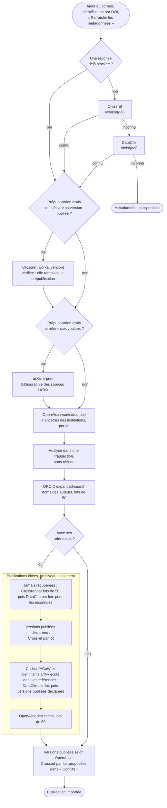

# Sources de métadonnées

Comment l'application récupère les métadonnées des publications auprès des sources
externes, ce que chacune apporte et laquelle fait foi. Vue d'ensemble du projet :
[architecture.md](architecture.md).

## Ce que chaque source apporte

| Source | Apporte | Fait foi pour | Requêtes |
|---|---|---|---|
| **Crossref** | Métadonnées de la plupart des articles, auteurs tels que publiés, bibliographie | La fiche, en priorité | Un DOI, lots de 50 DOI (`filter=doi:…`), recherche bibliographique (identification), ISBN |
| **DataCite** | DOI que Crossref ne connaît pas : actes JACoW, prépublications arXiv, Zenodo ; version publiée déclarée par les auteurs d'une prépublication | La fiche, quand Crossref ne connaît pas le DOI | Un DOI, lots de 50 (`ids=…`), recherche par titre (identification) |
| **arXiv** | Sources LaTeX d'une prépublication : sa bibliographie | La bibliographie d'une prépublication sans version publiée | Un e-print à la fois, 30 Mo au plus, pour les seules prépublications d'un corpus |
| **OpenAlex** | Institutions (ROR, lignée), ORCID manquants, résumé, date en ligne, regroupement des versions d'un article | Rien : il complète seulement | Une œuvre (gratuite), lots de 50 (budget quotidien), institutions par lots |
| **ORCID** | Noms déclarés par la personne ; profil et travaux | Rien : il complète le prénom ; le profil est seulement affiché | Recherche groupée de 50 noms à l'import ; enregistrement complet à la demande |
| **Open Library** | Livres sans DOI | La fiche d'un livre absent de Crossref | Un ISBN |
| **doi.org** | Existence d'un DOI saisi à la main | Le refus d'un faux DOI | `/ra/`, lots de 20 |

Quand plusieurs sources décrivent une publication, le parser lit la réponse de la
première qui la connaît, dans l'ordre **Crossref, DataCite, Open Library**, convertie au
format Crossref (`metadata_formats.py`). La bibliographie tirée d'arXiv ne sert que si
cette réponse n'en a pas.

## Parcours d'un import

`importer.import_publication` enchaîne les étapes ci-dessous. Chaque réponse est stockée
(`ExternalRecord`) et n'est plus redemandée : seul « Rafraîchir les métadonnées »
(`force_fetch`) rappelle les sources pour une publication déjà décrite. Les étapes de
l'encadré « Publications citées » n'ont lieu qu'avec les références, c'est-à-dire pour
une publication d'un corpus (sauf « à lire ») ou par « Importer ses références ».

Hors de ce parcours :

- **Livre par ISBN** (`books.find_or_import_book`) : Crossref (`filter=isbn:…`), puis Open
  Library. Un livre sans DOI n'est jamais envoyé aux sources de DOI.
- **DOI saisi à la main** (identification, ajout au corpus, import de fichier) : doi.org
  confirme d'abord qu'il existe ([corrections.md](corrections.md#identifier-une-référence)).
- **Page d'identification** d'une référence : Crossref (texte complet) et DataCite (titre)
  cherchent des candidats ([corrections.md](corrections.md#identifier-une-référence)).
- **Fiche d'un auteur** : l'enregistrement ORCID complet, à la demande.
- **Commandes** : `complete_affiliations`, `complete_orcid_names`, `replace_preprints`,
  `link_written_identifiers` traitent les publications déjà en base.

## Import d'une publication

1. Les vues appellent **explicitement** les services : `add_identified`
   (`services/corpus/entries.py`) pour un ajout au corpus, quel que soit le chemin
   (formulaire, bouton, import de fichier), et `import_publication`
   (`services/imports/importer.py`) dans les autres cas. `add_identified` envoie
   une publication avec DOI à `add_to_corpus` ; un livre sans DOI, trouvé par son ISBN
   (Crossref puis Open Library, `books.find_or_import_book`), n'est jamais envoyé aux sources
   de DOI. `entries.find_or_create` reconnaît le DOI ou l'ISBN d'une saisie ou d'une entrée.
   Une publication ajoutée « à lire » n'importe que ses propres métadonnées : sa
   bibliographie attend que son statut change (`entries.change_reading_status`), et
   `Publication.parse_references` ne compte que les entrées d'un autre statut (#234).
   Créer une `Publication` n'appelle jamais une source : il n'y a pas de signal.
2. Les métadonnées d'un article ne sont récupérées que si aucune source ne l'a encore décrit.
   Le seul moyen de rappeler les sources pour un article déjà récupéré est le bouton
   « Rafraîchir les métadonnées » (`force_fetch`).
3. Pour un article du corpus, les références sont analysées, puis les articles cités
   jamais récupérés sont importés, sans leurs propres références : on ne descend que d'un
   niveau.
4. Ces articles cités sont récupérés **par lots de 50** en une requête
   (`/works?filter=doi:A,doi:B,…`). Un DOI absent de la réponse est marqué comme
   récupéré, sans données, pour ne pas être redemandé par les imports suivants. Une
   action explicite (ajout au corpus, rafraîchissement) peut le redemander.
   Les fiches de ces requêtes de liste contiennent les mêmes auteurs et références qu'une
   requête unitaire. Il leur manque seulement des champs secondaires (`original-title`,
   `short-title`, `subject`, `subtitle`).

Mesuré sur un article de 1 012 auteurs et 100 références (88 avec DOI) : **3 requêtes
Crossref et environ 2 s**, réseau compris. Pour y arriver, l'analyse se fait dans une
transaction, sans les appels réseau. Les auteurs et les publications citées sont
résolus par requêtes groupées, et les créations passent par `bulk_create` : le nombre de
requêtes SQL ne croît pas avec le nombre d'auteurs ou de références.

**Décision : l'import est synchrone.** Grâce aux lots, il ne prend que quelques secondes
et ne demande aucune infrastructure supplémentaire. Le service est isolé des vues, si
bien qu'il pourra passer en tâche de fond plus tard sans toucher au reste (piste notée
dans #246 : file d'attente, regroupement entre utilisateurs, progression).

## Titres

Deux formes du titre sont gardées (`services/imports/titles.py`) :

- **Le titre de la source** (`Publication.title`) passe par `clean_title` : les entités
  HTML sont décodées, puis le balisage JATS ou MathML (`<i>`, ``, `<mml:math>`) est
  retiré ; le LaTeX est gardé tel quel. Certains éditeurs (IEEE) déposent un balisage
  échappé deux fois (`&lt;sub&gt;` dans la réponse JSON) : les entités sont décodées tant
  qu'il en reste, au plus trois fois, avant de retirer les balises (#263). La migration
  `0029` a nettoyé de la même façon les titres déjà en base, sauf ceux corrigés à la main.
  Ce titre fait foi : « Modifier » le montre, et l'export BibTeX garde son LaTeX.
- **Le titre lisible** (`Publication.readable_title`, #264) est tiré du premier par
  `readable_title` à chaque enregistrement : c'est lui qui est affiché, cherché et trié.
  Les titres de physique déposés par IEEE écrivent du LaTeX (`${\rm Nb}_{3}{\rm Sn}$`,
  `$\beta$`) ; la forme lisible le convertit : commandes de police (`\rm`, `\hbox`,
  `\mathrm`, `\textit`…) et accolades retirées, indices et exposants simples en
  caractères Unicode (`Nb₃Sn`, `10⁻³`), lettres grecques et quelques symboles (`β`, `±`,
  `°`). Une formule qui ne se rend pas entièrement (`\sqrt`, `T$_c$`, sans indice « c » en
  Unicode) laisse tout le titre inchangé : pas de rendu approché. `save()`, `bulk_create`
  et `bulk_update` de `Publication` le tiennent à jour ; la migration `0031` l'a rempli
  pour les titres déjà en base.

## Bibliographies

Une bibliographie est stockée comme la source la donne (`CitedReference` : clé, position,
texte brut, DOI éventuel), et une référence avec un DOI valide est reliée à sa publication,
créée au besoin sans ses propres références.

- **Ordre** : les références sont numérotées dans l'ordre de la réponse, sauf quand toutes
  leurs clés sont de la forme `ref<n>`, sans numéro répété : elles sont alors triées par
  `n` (`parser.in_numbered_order`, #258). IEEE dépose ses bibliographies dans le désordre
  chez Crossref (`ref4, ref3, ref10…` pour `10.1109/tasc.2014.2377730`), mais la clé garde
  le numéro de l'article. Toute autre forme de clé garde l'ordre reçu, sans deviner. La
  migration `0030_sort_ieee_references` a renuméroté les bibliographies déjà importées ;
  les décisions manuelles, portées par la référence et retrouvées par sa clé, suivent.
- **Sans DOI** : une référence qui écrit un code JACoW ou un identifiant arXiv est reliée
  après confirmation de DataCite ([arxiv-jacow.md](arxiv-jacow.md#identifiants-écrits-dans-une-référence)) ;
  les autres restent « à identifier » ([corrections.md](corrections.md#identifier-une-référence)).
- **Prépublication arXiv** sans version publiée : sa bibliographie est lue dans ses sources
  LaTeX ([arxiv-jacow.md](arxiv-jacow.md#bibliographie-tirée-des-sources-arxiv)).

## Requêtes HTTP

Tous les clients passent par `services/sources/http.py` : une session partagée, les mêmes règles
de nouvelles tentatives et la même journalisation. Le client Crossref s'identifie avec
`CROSSREF_MAILTO` pour accéder au *polite pool* (OpenAlex reçoit la même adresse). Les
clients respectent `Retry-After` sur les erreurs 429, retentent les 5xx et les erreurs
réseau, et ne retentent jamais une 404 ni une 403.

**Attente limitée dans une page** (#172). L'import est synchrone : pendant qu'une page
charge, une source en panne n'est retentée qu'une fois, et l'on abandonne si elle demande
d'attendre plus de 5 s (l'utilisateur pourra réessayer). Les commandes
(`complete_affiliations`, `replace_preprints`…) s'exécutent dans `patient_requests()` :
trois tentatives, et jusqu'à 60 s d'attente si la source le demande.

**Cache des réponses en développement.** Avec `DEBUG`, la session partagée est une
`CachedSession` de `requests-cache` (dépendance de développement) : les réponses 200 sont
gardées 7 jours dans `.http_cache.sqlite`, à part de la base. `reset_data` vide la base
mais garde ce cache (`--clear-http-cache` le vide aussi) : réimporter après un reset ne
redemande rien aux sources. En production, les réponses stockées (`ExternalRecord`)
évitent déjà de redemander une publication connue ; un cache HTTP n'y apporterait que
des données périmées. Les tests le désactivent.

## DOI enregistrés chez DataCite

Un DOI est attribué par une seule agence. **Crossref** couvre la plupart des articles,
**DataCite** les actes de conférence (JACoW, très cités en physique des accélérateurs),
les dépôts Zenodo, les prépublications arXiv et les jeux de données. Crossref répond
« inconnu » pour un DOI DataCite.

- Un DOI isolé : Crossref, puis DataCite (`/dois/<doi>`).
- Les articles cités : un lot Crossref, puis **un lot DataCite** (`/dois?ids=A,B,…`) pour
  les seuls DOI que Crossref ne connaît pas. Un DOI inconnu des deux n'est enregistré
  comme tel que si DataCite a répondu : en cas de panne, il est retenté au prochain import.
- Une fiche DataCite (titres, créateurs avec ORCID, date) est convertie au format lu par le
  parser. Elle ne contient en général pas de bibliographie : seuls les liens déclarés
  `References` ou `Cites` vers des DOI deviennent des références.

Les prépublications arXiv (version publiée, bibliographie LaTeX) et les actes JACoW
(identifiants écrits, ordre des auteurs) ont leur document :
[arxiv-jacow.md](arxiv-jacow.md).

## OpenAlex, source complémentaire

[OpenAlex](https://openalex.org) n'est pas un recours comme DataCite : il est interrogé
pour **tous** les DOI importés, en plus de Crossref et DataCite, parce qu'il apporte autre
chose. On y trouve les institutions avec leur identifiant ROR, des ORCID absents de
Crossref, des identifiants d'auteurs et la date de mise en ligne, et un
résumé pour la plupart des articles dont Crossref n'en donne pas (`abstract_inverted_index`,
remis en texte sur la fiche, avec sa source, #157). Il n'ajoute aucun
article : seuls ceux déjà importés (corpus et articles cités) sont complétés.

- Un article : une requête unitaire (gratuite). Elle n'est enregistrée que si OpenAlex a
  répondu, pour pouvoir la retenter en cas de panne.
- Les articles cités : un lot par 50 DOI (`filter=doi:A|B|…`). Une œuvre est retrouvée par
  **tous** ses DOI (`work_dois`) : une prépublication qu'OpenAlex connaît par le DOI de sa
  revue n'est pas prise pour inconnue. Un DOI absent d'une réponse est enregistré comme
  inconnu.
- Conditions (vérifiées le 2026-10-21) : API gratuite et sans clé. Une requête unitaire
  est illimitée. Les requêtes par lots consomment un budget quotidien d'environ 1 000 lots
  sans clé.

Ce qu'OpenAlex apporte sur les auteurs (affiliations et leur hiérarchie, ORCID manquants)
et les noms et profils ORCID sont décrits dans [auteurs.md](auteurs.md).

## Livres et ISBN

Un livre souvent cité sans DOI peut être identifié par son ISBN. On cherche d'abord dans
**Crossref** (`/works?filter=isbn:…`), qui connaît les livres académiques ayant un DOI.
On se replie ensuite sur **Open Library** (`/search.json?isbn=…`, gratuit et sans clé) :
un seul appel donne le titre, l'année et les noms des auteurs. Ces noms passent par la
même résolution que ceux de Crossref, mais sans ORCID. Les données stockées ne sont
jamais redemandées.

Limite connue : Open Library mélange parfois auteurs et contributeurs (directeur de
collection…). On corrige alors par fusion ou par correction d'auteur.

## Informations contradictoires entre sources

Comparaison faite sur 50 articles réels : 7 « années différentes », qui sont en fait la
date de mise en ligne (OpenAlex) face à la date imprimée (Crossref). Aucun ORCID
contradictoire, et 151 ORCID ajoutés. Quelques noms canoniques OpenAlex corrigent des
fautes de la fiche (« Rodrinuez » devient « Rodriguez »).

1. **On n'écrase jamais rien** : chaque source garde sa réponse brute.
2. **Crossref et DataCite font référence** pour la fiche : titre, date, auteurs tels que
   publiés, références (données de l'éditeur).
3. **OpenAlex et ORCID complètent** seulement : institutions, ORCID manquants, date en
   ligne, prénoms.
4. Les auteurs sont rapprochés par leur **position et leur nom publié**
   (`raw_author_name`). En cas de désaccord, rien n'est rattaché pour l'article. Une
   liste tronquée par OpenAlex (100 auteurs) ou vide d'un côté n'est pas un désaccord ;
   sans auteur chez Crossref ou DataCite, la fiche prend ceux d'OpenAlex (#265).
5. Un **vrai conflit** (un ORCID différent de celui déjà connu, un nom différent selon
   ORCID, une version publiée proposée) : l'existant est gardé et le conflit est signalé
   sur la page « Conflits » ([corrections.md](corrections.md#conflits)).
6. Les **corrections manuelles** l'emportent toujours.
7. Deux valeurs toutes deux justes (dates, nombres de citations) sont affichées avec leur
   source.
8. Une donnée connue pour être peu fiable, sans meilleure source structurée, est
   **signalée** plutôt que corrigée par une lecture de page web (ordre des auteurs JACoW).
