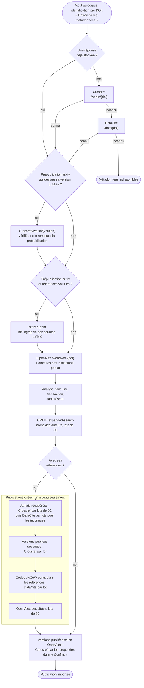

# Sources de métadonnées

Comment l'application récupère les métadonnées des publications auprès des sources
externes, ce que chacune apporte et laquelle fait foi. Vue d'ensemble du projet :
[architecture.md](architecture.md).

## Ce que chaque source apporte

| Source | Apporte | Fait foi pour | Requêtes |
|---|---|---|---|
| **Crossref** | Métadonnées de la plupart des articles, auteurs tels que publiés, bibliographie | La fiche, en priorité | Un DOI, lots de 50 DOI (`filter=doi:…`), recherche bibliographique (identification), ISBN |
| **DataCite** | DOI que Crossref ne connaît pas : actes JACoW, prépublications arXiv, Zenodo ; version publiée déclarée par les auteurs d'une prépublication | La fiche, quand Crossref ne connaît pas le DOI | Un DOI, lots de 50 (`ids=…`), recherche par titre (identification) |
| **arXiv** | Sources LaTeX d'une prépublication : sa bibliographie | La bibliographie d'une prépublication sans version publiée | Un e-print à la fois, 30 Mo au plus, pour les seules prépublications d'un corpus |
| **OpenAlex** | Institutions (ROR, lignée), ORCID manquants, résumé, date en ligne, regroupement des versions d'un article | Rien : il complète seulement | Une œuvre (gratuite), lots de 50 (budget quotidien), institutions par lots |
| **ORCID** | Noms déclarés par la personne ; profil et travaux | Rien : il complète le prénom ; le profil est seulement affiché | Recherche groupée de 50 noms à l'import ; enregistrement complet à la demande |
| **Open Library** | Livres sans DOI | La fiche d'un livre absent de Crossref | Un ISBN |
| **doi.org** | Existence d'un DOI saisi à la main | Le refus d'un faux DOI | `/ra/`, lots de 20 |

Quand plusieurs sources décrivent une publication, le parser lit la réponse de la
première qui la connaît, dans l'ordre **Crossref, DataCite, Open Library**, convertie au
format Crossref (`metadata_formats.py`). La bibliographie tirée d'arXiv ne sert que si
cette réponse n'en a pas.

## Parcours d'un import

`importer.import_publication` enchaîne les étapes ci-dessous. Chaque réponse est stockée
(`ExternalRecord`) et n'est plus redemandée : seul « Rafraîchir les métadonnées »
(`force_fetch`) rappelle les sources pour une publication déjà décrite. Les étapes de
l'encadré « Publications citées » n'ont lieu qu'avec les références, c'est-à-dire pour
une publication d'un corpus (sauf « à lire ») ou par « Importer ses références ».

Hors de ce parcours :

- **Livre par ISBN** (`books.find_or_import_book`) : Crossref (`filter=isbn:…`), puis Open
  Library. Un livre sans DOI n'est jamais envoyé aux sources de DOI.
- **DOI saisi à la main** (identification, ajout au corpus, import de fichier) : doi.org
  confirme d'abord qu'il existe ([corrections.md](corrections.md#identifier-une-référence)).
- **Page d'identification** d'une référence : Crossref (texte complet) et DataCite (titre)
  cherchent des candidats ([corrections.md](corrections.md#identifier-une-référence)).
- **Fiche d'un auteur** : l'enregistrement ORCID complet, à la demande.
- **Commandes** : `complete_affiliations`, `complete_orcid_names`, `replace_preprints`
  traitent les publications déjà en base.

## Import d'une publication

1. Les vues appellent **explicitement** les services : `services/corpus.add_identified`
   pour un ajout au corpus, quel que soit le chemin (formulaire, bouton, import de fichier),
   et `services/importer.import_publication` dans les autres cas. `add_identified` envoie
   une publication avec DOI à `add_to_corpus` ; un livre sans DOI, trouvé par son ISBN
   (Crossref puis Open Library, `books.find_or_import_book`), n'est jamais envoyé aux sources
   de DOI. `corpus.find_or_create` reconnaît le DOI ou l'ISBN d'une saisie ou d'une entrée.
   Une publication ajoutée « à lire » n'importe que ses propres métadonnées : sa
   bibliographie attend que son statut change (`corpus.change_reading_status`), et
   `Publication.parse_references` ne compte que les entrées d'un autre statut (#234).
   Créer une `Publication` n'appelle jamais une source : il n'y a pas de signal.
2. Les métadonnées d'un article ne sont récupérées que si aucune source ne l'a encore décrit.
   Le seul moyen de rappeler les sources pour un article déjà récupéré est le bouton
   « Rafraîchir les métadonnées » (`force_fetch`).
3. Pour un article du corpus, les références sont analysées, puis les articles cités
   jamais récupérés sont importés, sans leurs propres références : on ne descend que d'un
   niveau.
4. Ces articles cités sont récupérés **par lots de 50** en une requête
   (`/works?filter=doi:A,doi:B,…`). Un DOI absent de la réponse est marqué comme
   récupéré, sans données, pour ne pas être redemandé par les imports suivants. Une
   action explicite (ajout au corpus, rafraîchissement) peut le redemander.
   Les fiches de ces requêtes de liste contiennent les mêmes auteurs et références qu'une
   requête unitaire. Il leur manque seulement des champs secondaires (`original-title`,
   `short-title`, `subject`, `subtitle`).

Mesuré sur un article de 1 012 auteurs et 100 références (88 avec DOI) : **3 requêtes
Crossref et environ 2 s**, réseau compris. Pour y arriver, l'analyse se fait dans une
transaction, sans les appels réseau. Les auteurs et les publications citées sont
résolus par requêtes groupées, et les créations passent par `bulk_create` : le nombre de
requêtes SQL ne croît pas avec le nombre d'auteurs ou de références.

**Décision : l'import est synchrone.** Grâce aux lots, il ne prend que quelques secondes
et ne demande aucune infrastructure supplémentaire. Le service est isolé des vues, si
bien qu'il pourra passer en tâche de fond plus tard sans toucher au reste (piste notée
dans #246 : file d'attente, regroupement entre utilisateurs, progression).

## Requêtes HTTP

Tous les clients passent par `services/http.py` : une session partagée, les mêmes règles
de nouvelles tentatives et la même journalisation. Le client Crossref s'identifie avec
`CROSSREF_MAILTO` pour accéder au *polite pool* (OpenAlex reçoit la même adresse). Les
clients respectent `Retry-After` sur les erreurs 429, retentent les 5xx et les erreurs
réseau, et ne retentent jamais une 404 ni une 403.

**Attente limitée dans une page** (#172). L'import est synchrone : pendant qu'une page
charge, une source en panne n'est retentée qu'une fois, et l'on abandonne si elle demande
d'attendre plus de 5 s (l'utilisateur pourra réessayer). Les commandes
(`complete_affiliations`, `replace_preprints`…) s'exécutent dans `patient_requests()` :
trois tentatives, et jusqu'à 60 s d'attente si la source le demande.

**Cache des réponses en développement.** Avec `DEBUG`, la session partagée est une
`CachedSession` de `requests-cache` (dépendance de développement) : les réponses 200 sont
gardées 7 jours dans `.http_cache.sqlite`, à part de la base. `reset_data` vide la base
mais garde ce cache (`--clear-http-cache` le vide aussi) : réimporter après un reset ne
redemande rien aux sources. En production, les réponses stockées (`ExternalRecord`)
évitent déjà de redemander une publication connue ; un cache HTTP n'y apporterait que
des données périmées. Les tests le désactivent.

## DOI enregistrés chez DataCite

Un DOI est attribué par une seule agence. **Crossref** couvre la plupart des articles,
**DataCite** les actes de conférence (JACoW, très cités en physique des accélérateurs),
les dépôts Zenodo, les prépublications arXiv et les jeux de données. Crossref répond
« inconnu » pour un DOI DataCite.

- Un DOI isolé : Crossref, puis DataCite (`/dois/<doi>`).
- Les articles cités : un lot Crossref, puis **un lot DataCite** (`/dois?ids=A,B,…`) pour
  les seuls DOI que Crossref ne connaît pas. Un DOI inconnu des deux n'est enregistré
  comme tel que si DataCite a répondu : en cas de panne, il est retenté au prochain import.
- Une fiche DataCite (titres, créateurs avec ORCID, date) est convertie au format lu par le
  parser. Elle ne contient en général pas de bibliographie : seuls les liens déclarés
  `References` ou `Cites` vers des DOI deviennent des références.

## Prépublications arXiv

### Version publiée déclarée

Les DOI arXiv (`10.48550/arXiv.…`) sont chez DataCite, sans bibliographie (#227). Quand
les auteurs déclarent sur arXiv le DOI de la version publiée, DataCite le donne en
`IsVersionOf` : la publication est alors **remplacée** par cette version
(`services/preprints.py`), dont Crossref fournit métadonnées et bibliographie. Elle garde
ses entrées de corpus, ses citations et ses corrections ; le DOI arXiv passe dans
`preprint_doi`. Si la version publiée est déjà en base, la prépublication fusionne avec
elle (corpus et citations déplacés). Les références citées importées par lots le sont
aussi, avec un lot Crossref pour les versions déclarées.

Garde-fous, puisqu'on ne remplace que sur une information fiable :
- seul le préfixe arXiv compte (chez Zenodo, `IsVersionOf` relie une version à son concept) ;
- Crossref doit connaître le DOI comme publication (article de revue ou de conférence,
  chapitre, livre), jamais `posted-content` : des copies d'articles arXiv sont déposées
  ailleurs sous de nouveaux DOI (`10.65215/…` pour « Attention Is All You Need ») ;
- les titres doivent se ressembler (60 % des mots du plus court dans l'autre) : une faute
  de frappe dans le DOI déclaré désignerait un autre article.

Toutes les recherches par DOI passent par `Publication.objects.with_doi` /
`get_or_create_doi`, qui regardent aussi `preprint_doi`. La commande `replace_preprints`
applique le remplacement aux publications déjà en base, sans nouvel appel à DataCite.

### Version publiée trouvée par OpenAlex

Quand les auteurs ne déclarent rien, OpenAlex regroupe souvent la prépublication et sa
version publiée sous une même œuvre : ses `locations` donnent les DOI de toutes les
versions (`openalex_api.work_dois`). Ce regroupement est automatique et parfois faux (il
range les copies `10.65215/…` avec « Attention Is All You Need ») : la version n'est donc
jamais appliquée d'office, mais **proposée** comme conflit « Version publiée selon
OpenAlex » (`services/published_versions.py`).

- À la fin d'un import, pour la publication et, avec ses références, celles qu'elle cite :
  les DOI non arXiv de leur œuvre OpenAlex sont vérifiés chez Crossref en une requête par
  lot. Le premier qui passe les garde-fous ci-dessus et deux de plus (même premier auteur,
  année au moins égale à celle de la prépublication) est proposé ; une prépublication
  n'est examinée qu'une fois.
- « Prendre la valeur proposée » redemande la version à Crossref, la remplace comme une
  version déclarée (`replace_preprint`, ou fusion si elle est déjà en base, le conflit
  suivant la version publiée), puis la réimporte. Sans réponse de Crossref, rien n'est
  décidé.
- La fiche de la prépublication signale la proposition tant qu'elle est ouverte.
- `replace_preprints` propose aussi les versions des prépublications déjà en base, en
  redemandant leur œuvre OpenAlex quand elle manque.

### Bibliographie tirée des sources arXiv

Une prépublication sans version publiée déclarée n'a de bibliographie nulle part
ailleurs que dans le texte de ses auteurs. arXiv ne lance pas BibTeX : les auteurs
déposent le `.bbl`, ou écrivent `thebibliography` dans le `.tex`. Quand une telle
prépublication entre dans un corpus (ou par « Importer ses références »), son e-print
est téléchargé **une fois** (`arxiv_api.py`, 30 Mo au plus, lu en mémoire sans rien
extraire sur le disque) ; les entrées `\bibitem` sont stockées brutes dans un
`ExternalRecord` de source `arxiv` (`latex_bibliography.read_eprint`). À la lecture, elles
deviennent des références au format Crossref, au texte nettoyé du LaTeX (accents,
`\newblock`, `{\em …}`, `\bibinfo`…) : `metadata_message` les prend quand la source
prioritaire (DataCite) n'a pas de bibliographie. Un nettoyage amélioré s'applique donc
sans nouveau téléchargement.

Seuls les identifiants **écrits par les auteurs** relient une référence : un DOI, ou un
identifiant arXiv (DOI `10.48550/arXiv.…`, lui-même remplacé par sa version publiée s'il
en déclare une). Les autres restent « à identifier ». Sur « Attention Is All You Need » :
40 références, 22 reliées, 18 à identifier. La fiche dit d'où vient la bibliographie, ou
pourquoi elle manque : prépublication déposée en PDF seul (environ 30 % en physique des
accélérateurs), ou sources sans bibliographie.

## Actes JACoW

### Code JACoW écrit dans une référence

Les actes des conférences d'accélérateurs (JACoW) ont leurs DOI chez DataCite, sous une
forme fixe : `10.18429/JACoW-<CONFÉRENCE><ANNÉE>-<CODE>` (vérifié sur 5 000 de leurs 26 000
DOI ; les autres formes sont des volumes entiers). Un code `JACoW-IPAC2019-WEPRB007` écrit
dans une référence est donc un identifiant des auteurs : à l'import d'une bibliographie,
`jacow.link_jacow_references` le relie, mais seulement si DataCite connaît le DOI **et**
que son titre se retrouve dans la référence. Sinon rien n'est créé : un code faux ou trop
ancien ne laisse pas de publication vide dans la base.

### Ordre des auteurs incertain

L'ordre des auteurs que JACoW dépose chez DataCite ne correspond pas toujours à celui de
l'article, où l'auteur principal vient en premier, suivi des coauteurs regroupés par
laboratoire (#250). Sur `JACoW-IPAC2023-TUPA193`, DataCite met O. Piquet en tête, l'article
M. Moscatello ; OpenAlex recopie DataCite. La page JACoW n'offre aucun export structuré :
plutôt que de lire son HTML, la fiche d'une publication JACoW le signale et renvoie à sa
page, qui fait foi.

## OpenAlex, source complémentaire

[OpenAlex](https://openalex.org) n'est pas un recours comme DataCite : il est interrogé
pour **tous** les DOI importés, en plus de Crossref et DataCite, parce qu'il apporte autre
chose. On y trouve les institutions avec leur identifiant ROR, des ORCID absents de
Crossref, des identifiants d'auteurs et la date de mise en ligne, et un
résumé pour la plupart des articles dont Crossref n'en donne pas (`abstract_inverted_index`,
remis en texte sur la fiche, avec sa source, #157). Il n'ajoute aucun
article : seuls ceux déjà importés (corpus et articles cités) sont complétés.

- Un article : une requête unitaire (gratuite). Elle n'est enregistrée que si OpenAlex a
  répondu, pour pouvoir la retenter en cas de panne.
- Les articles cités : un lot par 50 DOI (`filter=doi:A|B|…`). Une œuvre est retrouvée par
  **tous** ses DOI (`work_dois`) : une prépublication qu'OpenAlex connaît par le DOI de sa
  revue n'est pas prise pour inconnue. Un DOI absent d'une réponse est enregistré comme
  inconnu.
- Conditions (vérifiées le 2026-10-21) : API gratuite et sans clé. Une requête unitaire
  est illimitée. Les requêtes par lots consomment un budget quotidien d'environ 1 000 lots
  sans clé.

### Affiliations

Une affiliation est une propriété de la **signature** (`AuthorPublication.organizations`),
pas de la personne : « sur cet article, X a déclaré le laboratoire Y ». Les périodes d'un
auteur dans une organisation (première et dernière publication) **se calculent** et ne
sont pas stockées : un changement de laboratoire apparaît naturellement.

Les institutions viennent d'OpenAlex. Elles sont rattachées aux signatures par **position
et nom publié** : les mots du nom sont comparés quel que soit leur ordre, si bien que
« Thuillier, Thomas » (DataCite) correspond à « Thomas Thuillier ». Si le nombre d'auteurs
ou un nom diffère, rien n'est rattaché pour l'article. Une organisation est reconnue par
son identifiant OpenAlex ou par son ROR. Les liens sont recréés à chaque analyse, puisque
les signatures le sont aussi.

**Hiérarchie.** Les auteurs déclarent souvent plusieurs niveaux à la fois (« IRFU, CEA
Paris-Saclay »). OpenAlex donne la **lignée** de chaque institution, c'est-à-dire tous ses
ancêtres : IRFU appartient à la Direction de la Recherche Fondamentale, qui appartient au
CEA. Chaque organisation connaît ses ancêtres. Ceux qui ne figurent dans aucune signature
sont récupérés pendant l'étape OpenAlex, en une requête groupée (`/institutions?filter=
openalex:…`), pour que le parser n'ait jamais à appeler le réseau. Sur la fiche d'un
auteur, les organisations sont **regroupées par tutelle** (organisation sans ancêtre),
avec le détail des entités déclarées. Une unité mixte (CEA Paris-Saclay : CEA et
Université Paris-Saclay) apparaît sous chacune de ses tutelles.

Sur la fiche d'une publication, les affiliations sont présentées **comme dans un
article** : chaque auteur porte en exposant le numéro de ses affiliations, listées une
seule fois sous les auteurs, dans l'ordre d'apparition. Une signature n'affiche que ses
organisations **les plus précises** : celles qui sont l'ancêtre d'une autre organisation
de la même signature sont retirées (IRFU plutôt que IRFU et CEA).

La commande `complete_affiliations` complète les publications déjà en base à partir des
données OpenAlex stockées, sans les redemander. L'option `--fetch-missing` interroge
d'abord OpenAlex, par lots, pour celles qui n'ont pas encore de réponse. L'option
`--refresh-ancestors` redemande les ancêtres déjà connus, pour réparer leurs propres
ancêtres.

### ORCID complétés depuis OpenAlex

Pour les auteurs rapprochés (même position, même nom publié), l'ORCID donné par OpenAlex
est attribué à l'**auteur** s'il n'en a pas. S'il en a un autre, rien ne change et un
conflit est signalé : « Prendre la valeur proposée » remplace alors l'ORCID. L'ORCID
publié de la signature (`published_orcid`, donnée Crossref) n'est jamais modifié : il fait
partie de la clé qui retrouve un auteur au ré-import. Mesuré sur la base réelle : les
auteurs avec ORCID passent de 35 à 74 sur 135, sans conflit. 11 ORCID se retrouvent
alors chacun sur plusieurs auteurs : ce sont des doublons certains, fusionnés
automatiquement ([corrections.md](corrections.md#même-orcid)).

## ORCID

L'API publique ORCID répond sans clé, en JSON quand on le demande (en-tête `Accept`).

**Profil, à la demande.** L'enregistrement d'une personne
(`https://pub.orcid.org/v3.0/<orcid>/record`) donne en une requête le profil et le résumé
des travaux. Il n'est **jamais demandé à l'import** : un article peut avoir plus de 1 000
auteurs. Le bouton « Compléter depuis ORCID » de la fiche d'un auteur qui a un ORCID le
demande, et la réponse est stockée (`OrcidRecord`). En cas d'échec, l'enregistrement déjà
stocké est gardé.

La fiche montre, à titre d'information, sans rien modifier dans la base (#59) :
- le nom officiel, le nom d'usage et les autres noms déclarés (« J. Carberry ») ;
- le nombre de travaux déclarés et combien sont dans la base, retrouvés par leur DOI ;
- les travaux de la base où l'auteur ne figure pas parmi les signataires : un nom publié
  rattaché à un autre auteur, ou un ORCID manquant.

**Noms, à l'import** (`services/orcid_names.py`, #220). La recherche étendue
(`/expanded-search/?q=orcid:(A OR B …)`) donne les noms de 50 personnes en une requête
(mesuré : une URL de 1 200 caractères, une demi-seconde). À l'import d'une publication,
les auteurs dont l'ORCID n'a jamais été demandé le sont en une requête groupée ; ceux des
publications citées sont laissés à la commande `complete_orcid_names`, qui traite aussi
les auteurs déjà en base (`--refresh` redemande tout). ORCID donne le nom que la personne
déclare, souvent plus complet que le nom publié, mais rien n'est écrasé :
- un prénom qui **prolonge** le prénom connu le complète, mot par mot : « T. » devient
  « Thomas », « A. K. » devient « Angie K. » ; un prénom moins complet ne change rien ;
- le **nom de famille** de la base est gardé, sa casse étant plus fiable (« SIMON »,
  « vallcorba » sur ORCID) ; un prénom tout en minuscules ou en majuscules est remis en
  forme ;
- un nom qui **diffère** vraiment est signalé comme conflit (« Nom différent selon
  ORCID ») : un ORCID peut être mal attribué, notamment par la complétion OpenAlex ;
- un nom **corrigé à la main** (`name_edited`) n'est jamais modifié, et un nom non public
  ne change rien.

Le bouton de la fiche applique les mêmes règles au nom de l'enregistrement complet. Tant
que celui-ci n'a pas été demandé, la fiche montre les noms de la recherche groupée et
propose « Charger les travaux depuis ORCID ». Sur la base réelle : 59 ORCID en 2
requêtes, 42 prénoms complétés, 2 conflits légitimes (un nom mal découpé par Crossref,
« E. Fernandez Mora » ; un vrai désaccord).

Les autres noms déclarés permettraient plus tard de rapprocher automatiquement des
auteurs, et les travaux de relier un auteur à ses articles. On attend de voir ce que
donnent les données avant de l'automatiser.

## Livres et ISBN

Un livre souvent cité sans DOI peut être identifié par son ISBN. On cherche d'abord dans
**Crossref** (`/works?filter=isbn:…`), qui connaît les livres académiques ayant un DOI.
On se replie ensuite sur **Open Library** (`/search.json?isbn=…`, gratuit et sans clé) :
un seul appel donne le titre, l'année et les noms des auteurs. Ces noms passent par la
même résolution que ceux de Crossref, mais sans ORCID. Les données stockées ne sont
jamais redemandées.

Limite connue : Open Library mélange parfois auteurs et contributeurs (directeur de
collection…). On corrige alors par fusion ou par correction d'auteur.

## Informations contradictoires entre sources

Comparaison faite sur 50 articles réels : 7 « années différentes », qui sont en fait la
date de mise en ligne (OpenAlex) face à la date imprimée (Crossref). Aucun ORCID
contradictoire, et 151 ORCID ajoutés. Quelques noms canoniques OpenAlex corrigent des
fautes de la fiche (« Rodrinuez » devient « Rodriguez »).

1. **On n'écrase jamais rien** : chaque source garde sa réponse brute.
2. **Crossref et DataCite font référence** pour la fiche : titre, date, auteurs tels que
   publiés, références (données de l'éditeur).
3. **OpenAlex et ORCID complètent** seulement : institutions, ORCID manquants, date en
   ligne, prénoms.
4. Les auteurs sont rapprochés par leur **position et leur nom publié**
   (`raw_author_name`). En cas de désaccord, rien n'est rattaché pour l'article.
5. Un **vrai conflit** (un ORCID différent de celui déjà connu, un nom différent selon
   ORCID, une version publiée proposée) : l'existant est gardé et le conflit est signalé
   sur la page « Conflits » ([corrections.md](corrections.md#conflits)).
6. Les **corrections manuelles** l'emportent toujours.
7. Deux valeurs toutes deux justes (dates, nombres de citations) sont affichées avec leur
   source.
8. Une donnée connue pour être peu fiable, sans meilleure source structurée, est
   **signalée** plutôt que corrigée par une lecture de page web (ordre des auteurs JACoW).
